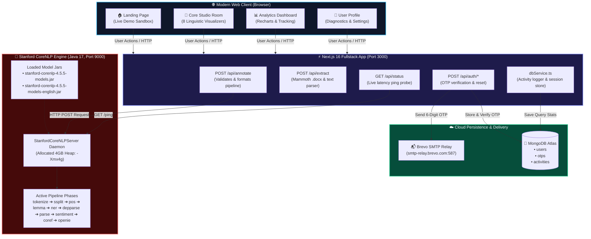
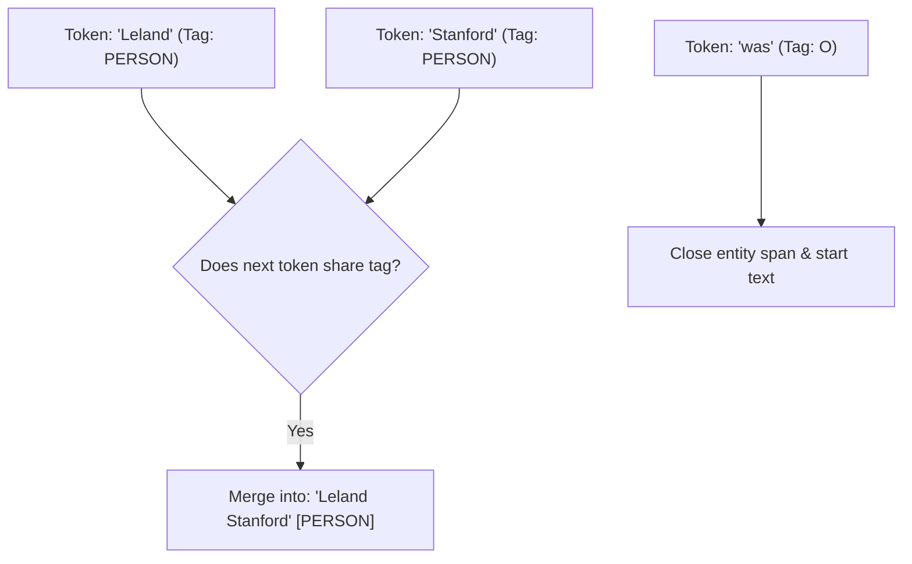
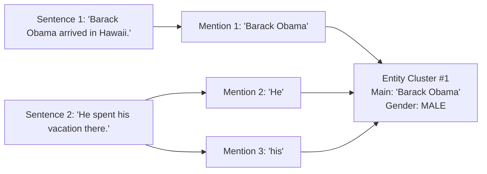
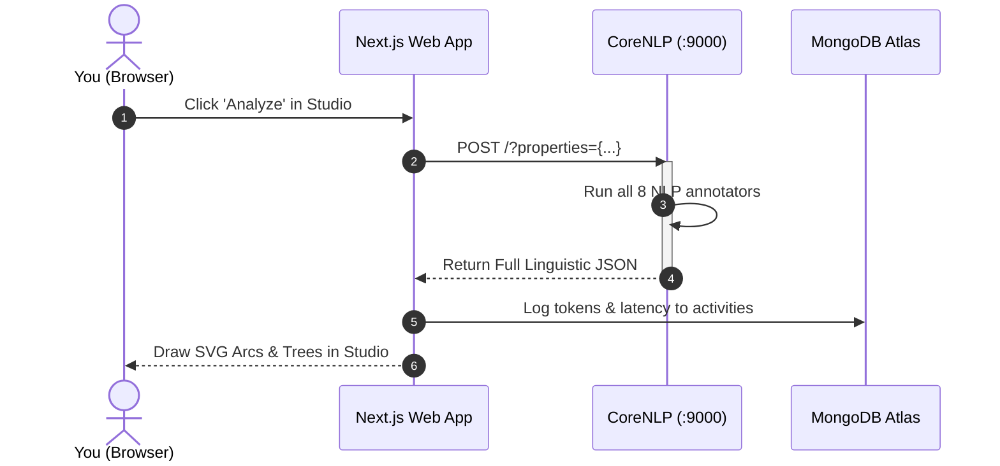

# Textra &mdash; Modern Natural Language Processing Studio

<p align="center">
  
</p>

<p align="center">
  <strong>An intuitive, visual NLP studio that connects the power of Stanford CoreNLP with a modern web app. Explore sentence structure, parts of speech, named entities, sentiment, and semantic facts with real-time visualizers.</strong>
</p>

<p align="center">
  <a href="https://nextjs.org/"></a>
  <a href="https://react.dev/"></a>
  <a href="https://www.typescriptlang.org/"></a>
  <a href="https://www.python.org/"></a>
  <a href="https://pytorch.org/"></a>
  <a href="https://stanfordnlp.github.io/stanza/"></a>
  <a href="https://stanfordnlp.github.io/CoreNLP/"></a>
  <a href="https://www.mongodb.com/"></a>
  <a href="https://tailwindcss.com/"></a>
  <a href="https://www.brevo.com/"></a>
</p>

---

## Table of Contents

- [1. About Textra](#1-about-textra)
  - [1.1 What is Textra?](#11-what-is-textra)
  - [1.2 The Problem Textra Solves](#12-the-problem-textra-solves)
- [2. NLP Concepts Explained Simply](#2-nlp-concepts-explained-simply)
  - [2.1 Sentence Splitting & Tokenization](#21-sentence-splitting--tokenization)
  - [2.2 Lemmatization](#22-lemmatization)
  - [2.3 Parts of Speech (POS Tagging)](#23-parts-of-speech-pos-tagging)
  - [2.4 Named Entity Recognition (NER)](#24-named-entity-recognition-ner)
  - [2.5 Constituency Parse Trees](#25-constituency-parse-trees)
  - [2.6 Universal Dependency Arcs](#26-universal-dependency-arcs)
  - [2.7 Deep Recursive Sentiment Analysis](#27-deep-recursive-sentiment-analysis)
  - [2.8 Coreference Resolution](#28-coreference-resolution)
  - [2.9 Open Information Extraction (Open IE)](#29-open-information-extraction-open-ie)
- [3. Complete Annotation Guide](#3-complete-annotation-guide)
  - [3.1 Parts of Speech (Penn Treebank Tags)](#31-parts-of-speech-penn-treebank-tags)
  - [3.2 Named Entity Types](#32-named-entity-types)
  - [3.3 Dependency Grammatical Relations](#33-dependency-grammatical-relations)
  - [3.4 Sentiment Scale](#34-sentiment-scale)
  - [3.5 Coreference & Open IE Triplets](#35-coreference--open-ie-triplets)
- [4. System Architecture & Visual Flowcharts](#4-system-architecture--visual-flowcharts)
  - [4.1 Modern Architecture Flow](#41-modern-architecture-flow)
  - [4.2 How the Components Talk to Each Other](#42-how-the-components-talk-to-each-other)
  - [4.3 Tech Stack Breakdown](#43-tech-stack-breakdown)
- [5. Visual Workflows & Sequence Diagrams](#5-visual-workflows--sequence-diagrams)
  - [5.1 Pipeline Execution Flow](#51-pipeline-execution-flow)
  - [5.2 Continuous Entity Merging](#52-continuous-entity-merging)
  - [5.3 Coreference Chain Linking](#53-coreference-chain-linking)
  - [5.4 Request & Persistence Sequence](#54-request--persistence-sequence)
- [6. Installation & Quickstart Guide](#6-installation--quickstart-guide)
  - [6.1 Prerequisites](#61-prerequisites)
  - [6.2 Step 1: Clone & Install Dependencies](#62-step-1-clone--install-dependencies)
  - [6.3 Step 2: Start the CoreNLP Java Server](#63-step-2-start-the-corenlp-java-server)
  - [6.4 Step 3: Configure Environment (.env.local)](#64-step-3-configure-environment-envlocal)
  - [6.5 Step 4: Run Next.js](#65-step-4-run-nextjs)
  - [6.6 Common Troubleshooting Tips](#66-common-troubleshooting-tips)
- [7. Practical Real-World Use Cases](#7-practical-real-world-use-cases)
- [8. Performance, Memory & Security](#8-performance-memory--security)
- [9. Limitations & What's Next](#9-limitations--whats-next)
- [10. Frequently Asked Questions (FAQ)](#10-frequently-asked-questions-faq)
- [11. References, License & Author](#11-references-license--author)

---

## 1. About Textra

### 1.1 What is Textra?

**Textra** is a web-based natural language processing (NLP) workbench. 

It takes raw, unstructured text—like a paragraph from an article, a customer review, or an uploaded `.docx` or `.txt` document—and breaks it down into clear, structured linguistic pieces. 

Instead of forcing you to read through thousands of lines of raw JSON from academic toolkits, Textra gives you **clean, interactive visuals**:
- Colored badges for parts of speech and root lemmas.
- Highlights for names, dates, organizations, and monetary values.
- Smooth SVG arcs showing how words connect grammatically.
- Expandable phrase trees showing how sentences are built.
- Accurate sentiment meters that catch subtle nuances and negation.
- Arrows showing what pronouns refer back to across paragraphs.
- Subject-Predicate-Object fact triplets pulled straight out of sentences.

Behind the scenes, it combines the battle-tested **Stanford CoreNLP Java engine** with a fast, modern **Next.js 16 (React 19)** web interface, backed by **MongoDB Atlas** for history and **Brevo SMTP** for email login codes.

### 1.2 The Problem Textra Solves

Human language is messy and ambiguous. A word like *"run"* can be a noun (*"a morning run"*) or a verb (*"I run fast"*). A phrase like *"not bad at all"* sounds negative if you just count words, but means something quite positive in context.

Most existing NLP tools fall into two camps:
1. **Academic toolkits (like Stanford CoreNLP or spaCy CLI)**: Incredibly accurate, but they output massive, dense JSON files that are difficult to inspect and share.
2. **Simplified cloud APIs**: Easy to call, but they only give you basic sentiment or a couple of entity tags, hiding the deep grammar and syntax trees underneath.

Textra bridges this gap. It gives you deep, academic-level linguistic analysis with the ease of a modern, responsive web application.

---

## 2. NLP Concepts Explained Simply

If you are new to Natural Language Processing, here is a straightforward explanation of what Textra does under the hood:

### 2.1 Sentence Splitting & Tokenization
- **What it is**: Splitting a block of text into sentences, and then breaking each sentence into individual words and punctuation marks (*tokens*).
- **Why it matters**: A computer cannot understand grammar without knowing where words start and end. Handling things like *"Mr. Smith visited the U.S. at 10 a.m."* requires rules so the periods in *"U.S."* do not accidentally end the sentence.
- **Example**: `"I can't wait!"` &rarr; `["I", "ca", "n't", "wait", "!"]`

### 2.2 Lemmatization
- **What it is**: Finding the root or base dictionary form of an inflected word (*lemma*).
- **Why it matters**: Words take many shapes depending on tense or number (*"running"*, *"ran"*, *"runs"*). Lemmatization converts them all back to *"run"*, making it much easier to search, index, or match text.
- **Example**: `"was"` &rarr; `"be"`, `"better"` &rarr; `"good"`, `"corpora"` &rarr; `"corpus"`

### 2.3 Parts of Speech (POS Tagging)
- **What it is**: Labeling each word with its grammatical role in the sentence (Noun, Verb, Adjective, Adverb, Pronoun, Preposition, etc.).
- **Why it matters**: It tells you what a word is *doing* in a sentence, which helps resolve ambiguous words.
- **Example**: In *"He books a room"*, *"books"* is tagged as a verb (`VBZ`), but in *"He read three books"*, it is tagged as a plural noun (`NNS`).

### 2.4 Named Entity Recognition (NER)
- **What it is**: Spotting real-world things in text and labeling them into categories like people, companies, places, dates, and currency amounts.
- **Why it matters**: It allows you to automatically pull names, company profiles, and dates out of emails, news, or resumes without reading them manually.
- **Example**: `"Elon Musk visited California in 2024"` &rarr; `Elon Musk` [PERSON], `California` [LOCATION], `2024` [DATE].

### 2.5 Constituency Parse Trees
- **What it is**: A tree diagram that shows how words group into phrases (Noun Phrases, Verb Phrases, Prepositional Phrases) to build a complete sentence.
- **Why it matters**: It reveals the hierarchical sentence blueprint according to formal grammar rules.
- **Example**: The sentence `[The engineer] [designed [a rocket]]` breaks down into a subject noun phrase and a predicate verb phrase.

### 2.6 Universal Dependency Arcs
- **What it is**: Arrows drawn directly between words showing which word depends on which, and what the grammatical relationship is.
- **Why it matters**: Unlike phrase trees, dependencies tell you directly *who did what to whom*.
- **Example**: In *"Jane founded the company"*, an arrow goes from *"founded"* to *"Jane"* labeled `nsubj` (nominal subject), and another arrow goes to *"company"* labeled `obj` (direct object).

### 2.7 Deep Recursive Sentiment Analysis
- **What it is**: Figuring out whether a sentence expresses positive, neutral, or negative feelings.
- **Why it matters**: Most basic sentiment tools just count "happy" or "sad" words. Textra uses Stanford's Recursive Neural Tensor Network, which reads the sentence structure from the bottom up. This means it understands that *"not great"* is negative, while *"not bad"* is positive.
- **Scale**: Rated from `Very Negative` to `Very Positive` along with probability percentages.

### 2.8 Coreference Resolution
- **What it is**: Linking different words across sentences that point to the exact same person, thing, or entity.
- **Why it matters**: If someone writes *"Barack Obama arrived in Hawaii. He spent his vacation there."*, coreference resolution understands that *"He"* and *"his"* mean *"Barack Obama"*, and *"there"* means *"Hawaii"*.
- **Example**: Groups `["Elon Musk", "He", "his"]` into one unified entity cluster.

### 2.9 Open Information Extraction (Open IE)
- **What it is**: Pulling factual statements out of natural sentences and turning them into simple `(Subject, Relation, Object)` triplets.
- **Why it matters**: Perfect for turning written articles into structured databases or knowledge graphs.
- **Example**: *"Google developed Android for smartphones"* &rarr; `(Google, developed, Android)`.

---

## 3. Complete Annotation Guide

### 3.1 Parts of Speech (Penn Treebank Tags)

Textra uses the standard 36-tag Penn Treebank set, grouped and color-coded for quick visual reading:

| Category | Tags | What They Mean | Examples |
| :--- | :--- | :--- | :--- |
| **Nouns** | `NN`, `NNS`, `NNP`, `NNPS` | Singular, plural, and proper nouns | *server, algorithms, Stanford, Google* |
| **Verbs** | `VB`, `VBD`, `VBG`, `VBN`, `VBP`, `VBZ`, `MD` | Base verbs, past tense, gerunds, participles, modal verbs | *run, founded, analyzing, can, must* |
| **Adjectives** | `JJ`, `JJR`, `JJS` | Base, comparative, and superlative adjectives | *neural, faster, most accurate* |
| **Adverbs** | `RB`, `RBR`, `RBS`, `WRB` | Modifiers for verbs and adjectives | *quickly, faster, where, how* |
| **Pronouns** | `PRP`, `PRP$`, `WP`, `WP$` | Personal, possessive, and relative pronouns | *he, his, they, who, whose* |
| **Determiners**| `DT`, `WDT` | Articles and specifying words | *the, a, this, which* |
| **Numbers** | `CD` | Cardinal numbers and digits | *1885, 42, 3.14* |
| **Prepositions**| `IN` | Prepositions and subordinating conjunctions | *in, on, by, through, although* |
| **Conjunctions**| `CC` | Words linking clauses or words | *and, but, or* |
| **Particles** | `TO`, `RP` | Infinitives and phrasal verb particles | *to (go), up (pick up)* |

### 3.2 Named Entity Types

When you run text through Textra, it flags 13 distinct types of entities:

| Entity Tag | Category Description | Real-World Example |
| :--- | :--- | :--- |
| `PERSON` | People, names, historical figures | *Leland Stanford, Marie Curie, Barack Obama* |
| `ORGANIZATION` | Companies, universities, government bodies | *Stanford University, Google, NASA* |
| `LOCATION` | Regions, mountains, bodies of water | *Silicon Valley, Mount Fuji, Pacific Ocean* |
| `CITY` | Cities and municipalities | *Mountain View, London, New York* |
| `STATE_OR_PROVINCE`| States and provinces | *California, Ontario, Bavaria* |
| `COUNTRY` | Sovereign nations | *United States, India, Germany* |
| `DATE` | Specific dates, years, relative days | *1885, November 16, tomorrow* |
| `TIME` | Clock times and timestamps | *10:30 AM, 14:00 UTC* |
| `MONEY` | Currency and amounts | *$100 million, €45, 5,000 Yen* |
| `PERCENT` | Percentages and fractions | *99.2%, 15 percent* |
| `DURATION` | Lengths of time | *two weeks, 30 days, 4 years* |
| `NATIONALITY` | National or ethnic groups | *American, British, Japanese* |
| `MISC` | Specific events, awards, or artifacts | *World War II, Olympic Games, Pulitzer Prize* |

### 3.3 Dependency Grammatical Relations

These are the primary arrows drawn in Textra's SVG Dependency visualizer:

| Relation | Description | Example |
| :--- | :--- | :--- |
| `root` | The central verb or head of the whole sentence | *founded* in *"Stanford founded the school."* |
| `nsubj` | The subject doing the action | *Leland* &larr; `nsubj` &larr; *founded* |
| `nsubj:pass`| The subject receiving the action in passive voice | *University* &larr; `nsubj:pass` &larr; *was founded* |
| `obj` / `dobj`| Direct object receiving the verb's action | *founded* &rarr; `obj` &rarr; *university* |
| `iobj` | Indirect object | *gave* &rarr; `iobj` &rarr; *him* |
| `obl` | Prepositional or context phrase | *founded* &rarr; `obl` &rarr; *in California* |
| `amod` | Adjective modifying a noun | *quantum* &larr; `amod` &larr; *processor* |
| `advmod` | Adverb modifying a verb or adjective | *blazingly* &larr; `advmod` &larr; *fast* |
| `compound` | Words that combine into a single term | *quantum* &larr; `compound` &larr; *supremacy* |
| `case` | Preposition that marks a noun | *in* &larr; `case` &larr; *California* |
| `det` | Determiner or article attached to a noun | *the* &larr; `det` &larr; *processor* |
| `conj` / `cc` | Coordinated items and conjunctions | *Leland* &rarr; `conj` &rarr; *Jane* linked by *and* (`cc`) |

### 3.4 Sentiment Scale

Textra scores sentiment on a 5-step scale:

```
[ Very Negative ] ── [ Negative ] ── [ Neutral ] ── [ Positive ] ── [ Very Positive ]
     (Score 0)          (Score 1)       (Score 2)       (Score 3)          (Score 4)
```

Each sentence also includes an exact distribution curve showing how much confidence the neural network had across each of the 5 categories.

### 3.5 Coreference & Open IE Triplets

- **Coreference**: Textra groups mentions into numbered clusters (e.g., `Cluster #1: "Elon Musk"` with mentions *"Elon Musk"*, *"He"*, and *"his"*). It also detects gender (*Male, Female, Unknown*) and animacy (*Animate, Inanimate*).
- **Open IE Triplets**: Visualized as clean, interactive cards:
  ```
  [ Subject: Google ] ──( Relation: developed )──> [ Object: Android ]
  ```

---

## 4. System Architecture & Visual Flowcharts

### 4.1 Modern Architecture Flow

Here is how the entire Textra system is organized, from the browser in front of you down to the neural models and database:



### 4.2 How the Components Talk to Each Other

1. **The User Interface**: Built with React 19 and Tailwind CSS v4. When you click *"Analyze"*, the UI sends your text or uploaded file to Next.js.
2. **Next.js Server (Port 3000)**: Serves the pages and acts as a secure API gateway. It extracts text from `.docx` or `.txt` files, formats the request parameters, and sends them to CoreNLP.
3. **NLP Engine (Dual-Option Support)**:
   - **In-Project Python Engine (Port 8000 - Recommended)**: Powered by Stanford's official `stanza` neural pipeline and PyTorch. Runs directly inside the project with zero Java dependencies.
   - **Stanford CoreNLP Java Server (Port 9000)**: Stanford's classic Java 17 daemon running multi-threaded JAR models.
4. **Cloud Database (MongoDB Atlas)**: Automatically stores analysis logs (tokens processed, latency, and sentiment) and verification codes.
5. **Transactional Email (Brevo)**: Sends official 6-digit login codes to user emails over a secure TLS SMTP connection.

### 4.3 Tech Stack Breakdown

| Layer | Technology | Version | What It Does |
| :--- | :--- | :--- | :--- |
| **Web Framework** | Next.js | `16.4.6` | App router, server routes, fast Turbopack builds |
| **UI Library** | React | `19.3.0` | Powers the reactive studio canvas and visual components |
| **Styling** | Tailwind CSS | `4.3.3` | Clean dark-mode UI with modern glassmorphism styling |
| **Visual Charts** | Recharts | `3.10.1` | Line/Area charts, Donut charts, and Bar charts for dashboard |
| **Python NLP Engine** | Stanford Stanza & PyTorch | `1.15.1` / `2.14+` | In-project Python neural engine emitting exact CoreNLP ASTs |
| **Java NLP Engine** | Stanford CoreNLP | `4.5.5` | Alternative Java server for Stanford's classic pipeline |
| **Python Runtime** | FastAPI & Uvicorn | `0.100+` | Ultra-fast ASGI microservice running the in-project models |
| **Database** | MongoDB Atlas | `v6.x` | Cloud document storage for users, OTPs, and activities |
| **Email Relay** | Brevo (Sendinblue) | SMTP TLS | Sends login and password reset verification codes |
| **Document Reader**| Mammoth.js | `1.13.0` | Extracts raw text from `.docx` Microsoft Word documents |

---

## 5. Visual Workflows & Sequence Diagrams

### 5.1 Pipeline Execution Flow

Here is the step-by-step path text takes inside the Stanford CoreNLP engine:

```mermaid
flowchart LR
  A[Raw Text] --> B[1. Tokenize & Split]
  B --> C[2. POS Tagging]
  C --> D[3. Lemmatization]
  D --> E[4. Named Entities]
  E --> F[5. Dependency Arcs]
  F --> G[6. Parse Trees]
  G --> H[7. Sentiment Network]
  H --> I[8. Coreference]
  I --> J[9. Open IE Facts]
  J --> K[Interactive Studio UI]
```



### 5.2 Continuous Entity Merging

How Textra automatically groups multi-word names into single entity chips:



### 5.3 Coreference Chain Linking

How Textra ties pronouns and references back to the original subject across multiple sentences:



### 5.4 Request & Persistence Sequence

How the browser, server, CoreNLP, and database work together on every click:



---

## 6. Installation & Quickstart Guide

Getting Textra running on your local machine is simple. Textra gives you **two flexible options** for the NLP engine:

1. **Option A (Recommended & In-Project)**: Run the Python Stanford Stanza neural engine (`python_engine/`) on port `8000` &mdash; no Java installation required!
2. **Option B (Classic)**: Run the Stanford CoreNLP Java server on port `9000`.

Textra automatically detects whichever engine is running!

### 6.1 Prerequisites

Make sure you have:
- **Node.js**: `v20.x` or higher ([Download Node.js](https://nodejs.org/))
- **Python**: `3.10+` with PyTorch (for Option A, Recommended)
- *Optional for Option B*: **Java**: Java 17 JDK or higher ([Download OpenJDK 17](https://learn.microsoft.com/en-us/java/openjdk/download))

### 6.2 Step 1: Clone & Install Dependencies

Clone this repository and install the Node packages:

```bash
git clone https://github.com/Shaik673/Textra.git
cd Textra
npm install
```

### 6.3 Step 2: Start the NLP Engine

#### Option A: In-Project Python NLP Engine (Recommended)

In your first terminal, install the Python requirements and start the engine:

```bash
# 1. Install Python neural dependencies
pip install -r python_engine/requirements.txt

# 2. Start the Python NLP engine on port 8000
npm run engine
# or: python python_engine/server.py
```

> **How to verify Option A**: Open `http://localhost:8000/ping` in your browser. It should display `pong`.
>
> **Direct CLI usage**: You can also run annotations directly from terminal:
> ```bash
> npm run engine:cli -- "Stanford University was founded in California."
> ```

#### Option B: Classic Stanford CoreNLP Java Server

If you prefer using the Java daemon:

```bash
# Navigate to the CoreNLP directory where the model JARs are located
cd CoreNLP

# Start the CoreNLP server daemon on port 9000 with 4GB heap
java -Xmx4g -cp "target/classes;src;lib/*;liblocal/*" edu.stanford.nlp.pipeline.StanfordCoreNLPServer -port 9000 -timeout 30000
```

> **How to verify Option B**: Open `http://localhost:9000/ping` in your browser. It should display `pong`.

### 6.4 Step 3: Configure Environment (.env.local)

In the `Textra` root folder, copy the example environment file:

```bash
cp .env.example .env.local
```

Open `.env.local` and add your credentials:

```env
# NLP Engine (Port 8000 for Python Stanza, or Port 9000 for Java CoreNLP)
CORENLP_URL=http://localhost:8000
NEXT_PUBLIC_CORENLP_URL=http://localhost:8000

# Brevo (Sendinblue) SMTP for login verification codes
BREVO_SMTP_HOST=smtp-relay.brevo.com
BREVO_SMTP_PORT=587
BREVO_SMTP_USER=your_brevo_login_email@example.com
BREVO_SMTP_KEY=your_brevo_smtp_master_api_key
BREVO_FROM_EMAIL=verify@textra-nlp.com

# Social OAuth Redirect URIs
GOOGLE_CLIENT_ID=your_google_client_id.apps.googleusercontent.com
GOOGLE_CLIENT_SECRET=your_google_client_secret
GOOGLE_REDIRECT_URI=http://localhost:3000/api/auth/callback/google

GITHUB_CLIENT_ID=your_github_client_id
GITHUB_CLIENT_SECRET=your_github_client_secret
GITHUB_REDIRECT_URI=http://localhost:3000/api/auth/callback/github

LINKEDIN_CLIENT_ID=your_linkedin_client_id
LINKEDIN_CLIENT_SECRET=your_linkedin_client_secret
LINKEDIN_REDIRECT_URI=http://localhost:3000/api/auth/callback/linkedin

# MongoDB Atlas Connection
MONGODB_URI=mongodb+srv://<username>:<password>@cluster0.xxxxx.mongodb.net/?retryWrites=true&w=majority
MONGODB_DB=textra_nlp
```

*(Note: If you do not have Brevo or MongoDB credentials right now, that's completely fine! Textra will automatically run in development mode with a master OTP code `123456`.)*

### 6.5 Step 4: Run Next.js

In your second terminal window, run:

```bash
npm run dev
```

Now open [http://localhost:3000](http://localhost:3000) in your web browser. You're ready to analyze text!

### 6.6 Common Troubleshooting Tips

- **Server says `Unable to connect to CoreNLP`**: Check your first terminal window. Make sure Java 17 is running on port 9000.
- **Port 9000 is already in use**: If another process is using port 9000, stop it or launch CoreNLP on another port and update `CORENLP_URL` in `.env.local`.
- **Model not found error**: Make sure `stanford-corenlp-4.5.5-models.jar` and `stanford-corenlp-4.5.5-models-english.jar` are placed inside the `CoreNLP/lib/` folder.
- **MongoDB connection timeout**: Make sure your current IP address is whitelisted in your MongoDB Atlas dashboard under *Network Access*.

---

## 7. Practical Real-World Use Cases

Textra is designed for practical everyday language tasks:

1. **Research Paper & Literature Review**:
   - Upload academic papers (`.docx` or `.txt`) to pull out named researchers, methodologies, dates, and core factual triplets without skimming hundreds of pages.
2. **Legal Agreement Analysis**:
   - Quickly find entity names, corporate bodies, governing jurisdictions, execution dates, and obligation clauses in agreements.
3. **Product Reviews & Feedback Triage**:
   - Use deep recursive sentiment to accurately catch mixed customer sentiment where people love the performance but hate the price or battery life.
4. **Knowledge Graph Building**:
   - Take articles and pull out clean `(Subject, Relation, Object)` facts that can be imported straight into graph databases like Neo4j.
5. **Resume & Talent Screening**:
   - Extract candidate names, organizations they worked for, locations, and timeframes automatically.

---

## 8. Performance, Memory & Security

- **Memory Management**: The CoreNLP Java engine loads heavy neural models into RAM once at startup. Allocating 4GB (`-Xmx4g`) provides plenty of room for processing multi-page documents without memory pressure.
- **Connection Caching**: Database connections to MongoDB Atlas are cached across requests, so the app never runs out of network sockets during heavy traffic.
- **Safety First**: Your sensitive API keys, email passwords, and database connection strings stay in `.env.local` and are completely ignored by Git. Only the safe `.env.example` template is committed to GitHub.

---

## 9. Limitations & What's Next

### Current Limitations
- **Language**: Textra is currently configured out of the box for English text. Adding German, Spanish, French, or Chinese requires downloading the respective Stanford language model JARs.
- **File Sizes**: Ingestion is optimized for single documents up to 100KB in plain text or `.docx`. Very large books or datasets should be processed in sections.

### Future Roadmap
- [ ] Add direct PDF reading with OCR support.
- [ ] One-click export of Open IE triplets to Neo4j graph databases.
- [ ] Pre-packaged Docker Compose file to start both Java and Next.js with a single `docker compose up` command.
- [ ] Multilingual model switcher in the UI settings tab.

---

## 10. Frequently Asked Questions (FAQ)

<details>
<summary><strong>Do I need an active internet connection to analyze text?</strong></summary>
No. The core NLP processing happens 100% locally on your machine via the Java daemon on port 9000. Internet is only used if you connect to remote MongoDB Atlas or send emails through Brevo.
</details>

<details>
<summary><strong>Can I test the website without setting up Brevo email?</strong></summary>
Yes! If Brevo keys are not present in <code>.env.local</code>, the verification screen includes a one-click button: <em>"Fill Demo Master OTP (123456)"</em>. You can log in and test everything immediately.
</details>

<details>
<summary><strong>How do I analyze my own documents?</strong></summary>
Go to the <strong>Core Studio Room</strong> (<code>/studio</code>) and either drag and drop your <code>.docx</code>, <code>.txt</code>, <code>.md</code>, or <code>.csv</code> file into the upload zone, or click <em>Upload File</em>. Textra will extract the text automatically.
</details>

---

## 11. References, License & Author

### Academic References
- **Stanford CoreNLP**: Manning, Christopher D., et al. 2014. *The Stanford CoreNLP Natural Language Processing Toolkit*. In Proceedings of ACL.
- **Recursive Sentiment Models**: Socher, Richard, et al. 2013. *Recursive Deep Models for Semantic Compositionality Over a Sentiment Treebank*. In Proceedings of EMNLP.
- **Universal Dependencies**: Nivre, Joakim, et al. 2016. *Universal Dependencies: A Multilingual Treebank Collection*. In Proceedings of LREC.

### License & Author
- **Author**: Shaik Mahaboob Basha
- **Contact**: `smahaboob823@gmail.com`
- **Repository**: [https://github.com/Shaik673/Textra.git](https://github.com/Shaik673/Textra.git)
- **License**: MIT License &mdash; free for educational, research, and commercial use.

---

<p align="center">
  <strong>Built with care by Shaik Mahaboob Basha &bull; Powered by Stanford CoreNLP, Next.js & MongoDB</strong>
</p>
