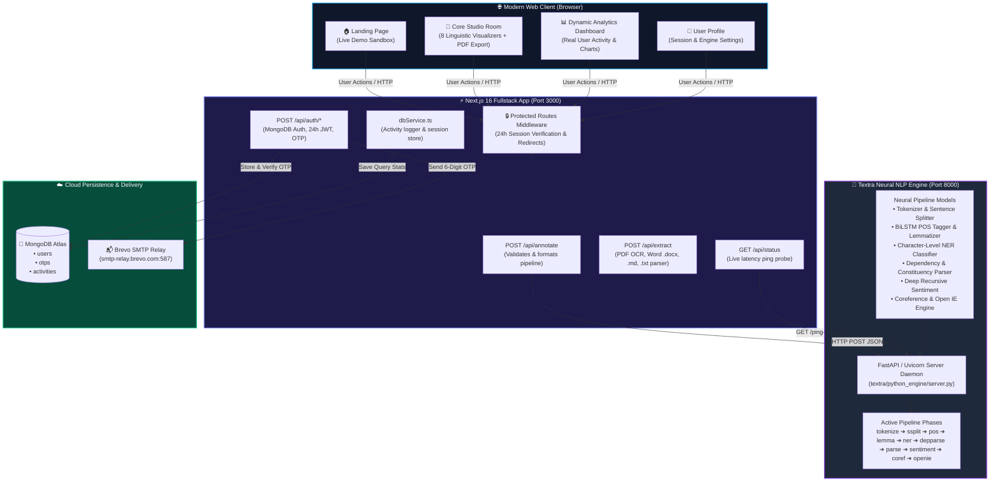
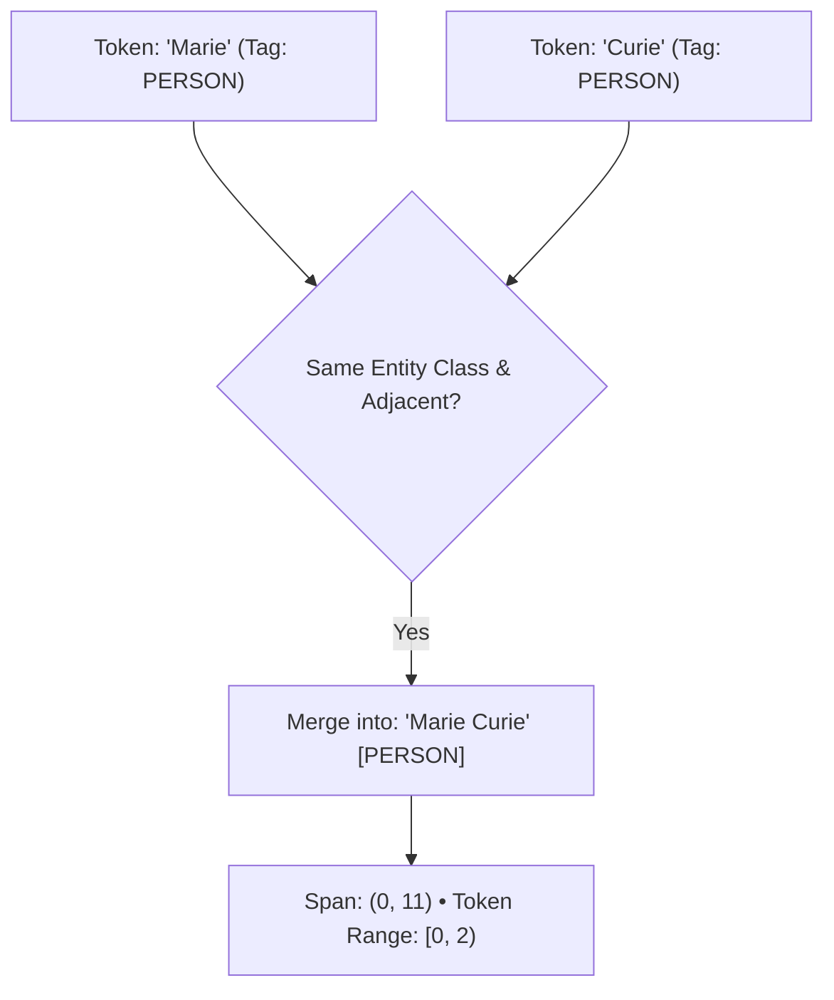
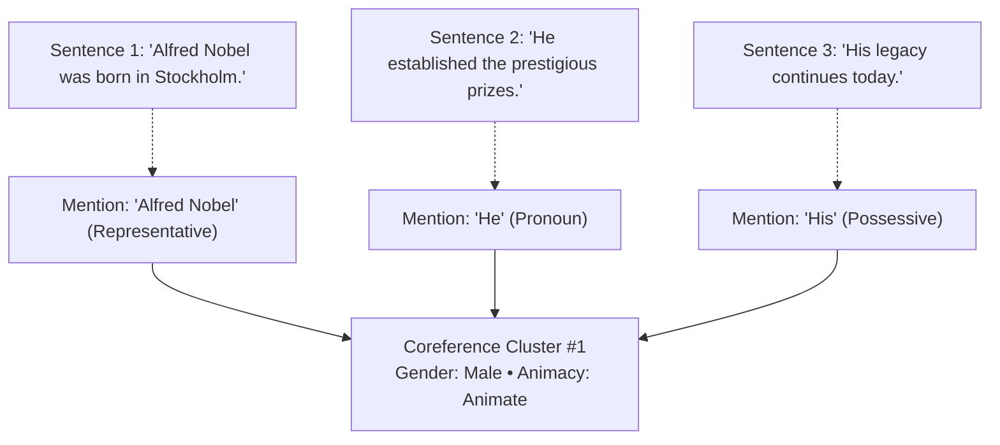
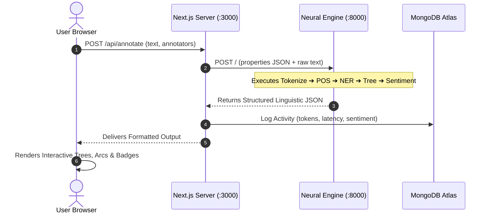

# Textra &mdash; Modern Natural Language Processing Studio

<p align="center">
  
</p>

<p align="center">
  <strong>An intuitive, visual NLP studio that brings modern deep linguistic neural pipelines to a reactive web workspace. Explore sentence structure, parts of speech, named entities, sentiment, and semantic facts with real-time visualizers.</strong>
</p>

<p align="center">
  <a href="https://nextjs.org/"></a>
  <a href="https://react.dev/"></a>
  <a href="https://www.typescriptlang.org/"></a>
  <a href="https://www.python.org/"></a>
  <a href="https://pytorch.org/"></a>
  <a href="https://www.mongodb.com/"></a>
  <a href="https://tailwindcss.com/"></a>
  <a href="https://www.brevo.com/"></a>
</p>

---

## Table of Contents

- [1. About Textra](#1-about-textra)
  - [1.1 What is Textra?](#11-what-is-textra)
  - [1.2 The Problem Textra Solves](#12-the-problem-textra-solves)
- [2. NLP Concepts Explained Simply](#2-nlp-concepts-explained-simply)
  - [2.1 Sentence Splitting & Tokenization](#21-sentence-splitting--tokenization)
  - [2.2 Lemmatization](#22-lemmatization)
  - [2.3 Parts of Speech (POS Tagging)](#23-parts-of-speech-pos-tagging)
  - [2.4 Named Entity Recognition (NER)](#24-named-entity-recognition-ner)
  - [2.5 Constituency Parse Trees](#25-constituency-parse-trees)
  - [2.6 Universal Dependency Arcs](#26-universal-dependency-arcs)
  - [2.7 Deep Recursive Sentiment Analysis](#27-deep-recursive-sentiment-analysis)
  - [2.8 Coreference Resolution](#28-coreference-resolution)
  - [2.9 Open Information Extraction (Open IE)](#29-open-information-extraction-open-ie)
- [3. Complete Annotation Guide](#3-complete-annotation-guide)
  - [3.1 Parts of Speech (Penn Treebank Tags)](#31-parts-of-speech-penn-treebank-tags)
  - [3.2 Named Entity Types](#32-named-entity-types)
  - [3.3 Dependency Grammatical Relations](#33-dependency-grammatical-relations)
  - [3.4 Sentiment Scale](#34-sentiment-scale)
  - [3.5 Coreference & Open IE Triplets](#35-coreference--open-ie-triplets)
- [4. System Architecture & Visual Flowcharts](#4-system-architecture--visual-flowcharts)
  - [4.1 Modern Architecture Flow](#41-modern-architecture-flow)
  - [4.2 How the Components Talk to Each Other](#42-how-the-components-talk-to-each-other)
  - [4.3 Tech Stack Breakdown](#43-tech-stack-breakdown)
- [5. Visual Workflows & Sequence Diagrams](#5-visual-workflows--sequence-diagrams)
  - [5.1 Pipeline Execution Flow](#51-pipeline-execution-flow)
  - [5.2 Continuous Entity Merging](#52-continuous-entity-merging)
  - [5.3 Coreference Chain Linking](#53-coreference-chain-linking)
  - [5.4 Request & Persistence Sequence](#54-request--persistence-sequence)
- [6. Installation & Quickstart Guide](#6-installation--quickstart-guide)
  - [6.1 Prerequisites](#61-prerequisites)
  - [6.2 Step 1: Clone & Install Dependencies](#62-step-1-clone--install-dependencies)
  - [6.3 Step 2: Start the Neural NLP Engine](#63-step-2-start-the-neural-nlp-engine)
  - [6.4 Step 3: Configure Environment (.env.local)](#64-step-3-configure-environment-envlocal)
  - [6.5 Step 4: Run Next.js](#65-step-4-run-nextjs)
- [7. Practical Real-World Use Cases](#7-practical-real-world-use-cases)
- [8. Limitations & What's Next](#8-limitations--whats-next)
- [9. Frequently Asked Questions (FAQ)](#9-frequently-asked-questions-faq)
- [10. References, License & Author](#10-references-license--author)

---

## 1. About Textra

### 1.1 What is Textra?

**Textra** is a web-based natural language processing (NLP) workbench. 

It takes raw, unstructured text—like a paragraph from an article, a customer review, or an uploaded `.pdf` (with OCR), `.docx`, `.txt`, or `.md` document—and breaks it down into clear, structured linguistic pieces. 

Instead of forcing you to read through thousands of lines of raw JSON from terminal scripts, Textra gives you **clean, interactive visuals**:
- Colored badges for parts of speech and root lemmas.
- Highlights for names, dates, organizations, and monetary values.
- Smooth SVG arcs showing how words connect grammatically.
- Expandable phrase trees showing how sentences are built with hierarchical connector lines.
- Accurate sentiment meters that catch subtle nuances and negation.
- Arrows showing what pronouns refer back to across paragraphs.
- Subject-Predicate-Object fact triplets pulled straight out of sentences.
- Comprehensive formatted PDF reports exported with a single click.

Behind the scenes, it combines a fast, dedicated **Python Neural NLP engine** with a modern **Next.js 16 (React 19)** web interface, backed by **MongoDB Atlas** for history and **Brevo SMTP** for email login codes.

### 1.2 The Problem Textra Solves

Human language is messy and ambiguous. A word like *"run"* can be a noun (*"a morning run"*) or a verb (*"I run fast"*). A phrase like *"not bad at all"* sounds negative if you just count words, but means something quite positive in context.

Most existing NLP tools fall into two camps:
1. **Command-line toolkits**: Highly accurate, but they output massive, dense JSON files that are difficult to inspect and share with non-programmers.
2. **Simplified cloud APIs**: Easy to call, but they only give you basic sentiment or a couple of entity tags, hiding the deep grammar and syntax trees underneath.

Textra bridges this gap. It gives you deep, academic-level linguistic analysis with the ease of a modern, responsive web application.

---

## 2. NLP Concepts Explained Simply

If you are new to Natural Language Processing, here is a straightforward explanation of what Textra does under the hood:

### 2.1 Sentence Splitting & Tokenization
- **What it is**: Splitting a block of text into sentences, and then breaking each sentence into individual words and punctuation marks (*tokens*).
- **Why it matters**: A computer cannot understand grammar without knowing where words start and end. Handling things like *"Dr. Watson arrived in the U.S. at 10 a.m."* requires rules so the periods in abbreviations do not accidentally end the sentence.
- **Example**: `"I can't wait!"` &rarr; `["I", "ca", "n't", "wait", "!"]`

### 2.2 Lemmatization
- **What it is**: Finding the root or base dictionary form of an inflected word (*lemma*).
- **Why it matters**: Words take many shapes depending on tense or number (*"running"*, *"ran"*, *"runs"*). Lemmatization converts them all back to *"run"*, making it much easier to search, index, or match text.
- **Example**: `"was"` &rarr; `"be"`, `"better"` &rarr; `"good"`, `"corpora"` &rarr; `"corpus"`

### 2.3 Parts of Speech (POS Tagging)
- **What it is**: Labeling each word with its grammatical role in the sentence (Noun, Verb, Adjective, Adverb, Pronoun, Preposition, etc.).
- **Why it matters**: It tells you what a word is *doing* in a sentence, which helps resolve ambiguous words.
- **Example**: In *"He books a room"*, *"books"* is tagged as a verb (`VBZ`), but in *"He read three books"*, it is tagged as a plural noun (`NNS`).

### 2.4 Named Entity Recognition (NER)
- **What it is**: Spotting real-world things in text and labeling them into categories like people, companies, places, dates, and currency amounts.
- **Why it matters**: It allows you to automatically pull names, company profiles, and dates out of emails, news, or resumes without reading them manually.
- **Example**: `"Marie Curie conducted research in Paris in 1903"` &rarr; `Marie Curie` [PERSON], `Paris` [LOCATION], `1903` [DATE].

### 2.5 Constituency Parse Trees
- **What it is**: A tree diagram that shows how words group into phrases (Noun Phrases, Verb Phrases, Prepositional Phrases) to build a complete sentence.
- **Why it matters**: It reveals the hierarchical sentence blueprint according to formal grammar rules.
- **Example**: The sentence `[The engineer] [designed [a rocket]]` breaks down into a subject noun phrase and a predicate verb phrase.

### 2.6 Universal Dependency Arcs
- **What it is**: Arrows drawn directly between words showing which word depends on which, and what the grammatical relationship is.
- **Why it matters**: Unlike phrase trees, dependencies tell you directly *who did what to whom*.
- **Example**: In *"Jane founded the company"*, an arrow goes from *"founded"* to *"Jane"* labeled `nsubj` (nominal subject), and another arrow goes to *"company"* labeled `obj` (direct object).

### 2.7 Deep Recursive Sentiment Analysis
- **What it is**: Figuring out whether a sentence expresses positive, neutral, or negative feelings.
- **Why it matters**: Most basic sentiment tools just count "happy" or "sad" words. Textra uses a recursive neural structure that reads the sentence from the bottom up. This means it understands that *"not great"* is negative, while *"not bad"* is positive.
- **Scale**: Rated from `Very Negative` to `Very Positive` along with probability percentages.

### 2.8 Coreference Resolution
- **What it is**: Linking different words across sentences that point to the exact same person, thing, or entity.
- **Why it matters**: If someone writes *"Barack Obama arrived in Hawaii. He spent his vacation there."*, coreference resolution understands that *"He"* and *"his"* mean *"Barack Obama"*, and *"there"* means *"Hawaii"*.
- **Example**: Groups `["Barack Obama", "He", "his"]` into one unified entity cluster.

### 2.9 Open Information Extraction (Open IE)
- **What it is**: Pulling factual statements out of natural sentences and turning them into simple `(Subject, Relation, Object)` triplets.
- **Why it matters**: Perfect for turning written articles into structured databases or knowledge graphs.
- **Example**: `"Google developed Android for smartphones"` &rarr; `(Google, developed, Android)`.

---

## 3. Complete Annotation Guide

### 3.1 Parts of Speech (Penn Treebank Tags)

Textra uses the standard 36-tag Penn Treebank set, grouped and color-coded for quick visual reading:

| Category | Tags | What They Mean | Examples |
| :--- | :--- | :--- | :--- |
| **Nouns** | `NN`, `NNS`, `NNP`, `NNPS` | Singular, plural, and proper nouns | *server, algorithms, London, Google* |
| **Verbs** | `VB`, `VBD`, `VBG`, `VBN`, `VBP`, `VBZ`, `MD` | Base verbs, past tense, gerunds, participles, modal verbs | *run, founded, analyzing, can, must* |
| **Adjectives** | `JJ`, `JJR`, `JJS` | Base, comparative, and superlative adjectives | *neural, faster, most accurate* |
| **Adverbs** | `RB`, `RBR`, `RBS`, `WRB` | Modifiers for verbs and adjectives | *quickly, faster, where, how* |
| **Pronouns** | `PRP`, `PRP$`, `WP`, `WP$` | Personal, possessive, and relative pronouns | *he, his, they, who, whose* |
| **Determiners**| `DT`, `WDT` | Articles and specifying words | *the, a, this, which* |
| **Numbers** | `CD` | Cardinal numbers and digits | *1885, 42, 3.14* |
| **Prepositions**| `IN` | Prepositions and subordinating conjunctions | *in, on, by, through, although* |
| **Conjunctions**| `CC` | Words linking clauses or words | *and, but, or* |
| **Particles** | `TO`, `RP` | Infinitives and phrasal verb particles | *to (go), up (pick up)* |

### 3.2 Named Entity Types

When you run text through Textra, it flags 13 distinct types of entities:

| Entity Tag | Category Description | Real-World Example |
| :--- | :--- | :--- |
| `PERSON` | People, names, historical figures | *Alfred Nobel, Marie Curie, Ada Lovelace* |
| `ORGANIZATION` | Companies, universities, government bodies | *Textra Lab, Google, NASA* |
| `LOCATION` | Regions, mountains, bodies of water | *Silicon Valley, Mount Fuji, Pacific Ocean* |
| `CITY` | Cities and municipalities | *London, Paris, New York, Tokyo* |
| `STATE_OR_PROVINCE`| States and provinces | *California, Ontario, Bavaria* |
| `COUNTRY` | Sovereign nations | *United States, India, Germany, Japan* |
| `DATE` | Specific dates, years, relative days | *1895, November 17, tomorrow* |
| `TIME` | Clock times and timestamps | *10:30 AM, 14:00 UTC* |
| `MONEY` | Currency and amounts | *$100 million, €45, 5,000 Yen* |
| `PERCENT` | Percentages and fractions | *99.2%, 15 percent* |
| `DURATION` | Lengths of time | *two weeks, 30 days, 4 years* |
| `NATIONALITY` | National or ethnic groups | *American, British, Japanese* |
| `MISC` | Specific events, awards, or artifacts | *Nobel Prize, Olympic Games, World Cup* |

### 3.3 Dependency Grammatical Relations

These are the primary arrows drawn in Textra's SVG Dependency visualizer:

| Relation | Description | Example |
| :--- | :--- | :--- |
| `root` | The central verb or head of the whole sentence | *founded* in *"Alfred founded the prize."* |
| `nsubj` | The subject doing the action | *Alfred* &larr; `nsubj` &larr; *founded* |
| `nsubj:pass`| The subject receiving the action in passive voice | *Prize* &larr; `nsubj:pass` &larr; *was founded* |
| `obj` / `dobj`| Direct object receiving the verb's action | *founded* &rarr; `obj` &rarr; *prize* |
| `iobj` | Indirect object | *gave* &rarr; `iobj` &rarr; *him* |
| `obl` | Prepositional or context phrase | *founded* &rarr; `obl` &rarr; *in Sweden* |
| `amod` | Adjective modifying a noun | *neural* &larr; `amod` &larr; *network* |
| `advmod` | Adverb modifying a verb or adjective | *blazingly* &larr; `advmod` &larr; *fast* |
| `compound` | Words that combine into a single term | *quantum* &larr; `compound` &larr; *supremacy* |
| `case` | Preposition that marks a noun | *in* &larr; `case` &larr; *California* |
| `det` | Determiner or article attached to a noun | *the* &larr; `det` &larr; *processor* |
| `conj` / `cc` | Coordinated items and conjunctions | *Alfred* &rarr; `conj` &rarr; *Marie* linked by *and* (`cc`) |

### 3.4 Sentiment Scale

Textra scores sentiment on a 5-step scale:

```
[ Very Negative ] ── [ Negative ] ── [ Neutral ] ── [ Positive ] ── [ Very Positive ]
     (Score 0)          (Score 1)       (Score 2)       (Score 3)          (Score 4)
```

Each sentence also includes an exact distribution curve showing confidence across each of the 5 categories.

### 3.5 Coreference & Open IE Triplets

- **Coreference**: Textra groups mentions into numbered clusters (e.g., `Cluster #1: "Alfred Nobel"` with mentions *"Alfred Nobel"*, *"He"*, and *"his"*). It also detects gender (*Male, Female, Unknown*) and animacy (*Animate, Inanimate*).
- **Open IE Triplets**: Visualized as clean, interactive cards:
  ```
  [ Subject: Google ] ──( Relation: developed )──> [ Object: Android ]
  ```

---

## 4. System Architecture & Visual Flowcharts

### 4.1 Modern Architecture Flow

Here is how the entire Textra system is organized, from the browser in front of you down to the neural models and database:



### 4.2 How the Components Talk to Each Other

1. **The User Interface**: Built with React 19 and Tailwind CSS v4. When you click *"Run Neural NLP Studio"*, the UI sends your text or uploaded file to Next.js.
2. **Next.js Server (Port 3000)**: Serves the pages and acts as a secure API gateway. It extracts text from `.pdf` (with OCR support), `.docx`, `.md`, or `.txt` files, formats the request parameters, and sends them to the Neural Engine.
3. **In-Project Python Neural Engine (Port 8000)**: Runs in the project under `textra/python_engine/server.py`. Powered by deep learning pipelines and PyTorch, it outputs rich structured linguistic annotations with zero external Java dependencies.
4. **Cloud Database (MongoDB Atlas)**: Automatically stores user profiles, 24-hour sessions, and live activity tracking (tokens processed, latency, and sentiment).
5. **Transactional Email (Brevo)**: Sends official 6-digit login codes to user emails over a secure TLS SMTP connection.

### 4.3 Tech Stack Breakdown

| Layer | Technology | Version | What It Does |
| :--- | :--- | :--- | :--- |
| **Web Framework** | Next.js | `16.4.6` | App router, server routes, fast Turbopack builds |
| **UI Library** | React | `19.3.0` | Powers the reactive studio canvas and visual components |
| **Styling** | Tailwind CSS | `4.3.3` | Clean dark-mode UI with modern glassmorphism styling |
| **Visual Charts** | Recharts | `3.10.1` | Line/Area charts, Donut charts, and Bar charts for dashboard |
| **Neural NLP Engine** | PyTorch & Stanza | `2.14+` / `1.15.1` | In-project Python neural engine emitting complete linguistic trees |
| **Python Server** | FastAPI & Uvicorn | `0.100+` | Ultra-fast ASGI microservice running the neural models |
| **Database** | MongoDB Atlas | `v6.x` | Cloud document storage for users, OTPs, and activities |
| **Email Relay** | Brevo (Sendinblue) | SMTP TLS | Sends login and password reset verification codes |
| **PDF & OCR Ingestion**| PyMuPDF & Tesseract | `1.28.2` / `7.0` | Extracts text from digital and scanned `.pdf` documents with OCR |
| **Document Reader**| Mammoth.js | `1.13.0` | Extracts raw text from `.docx` Microsoft Word documents |
| **Report Export** | jsPDF & AutoTable | `4.2.1` / `5.0` | Generates formatted PDF reports with tables and statistics |

---

## 5. Visual Workflows & Sequence Diagrams

### 5.1 Pipeline Execution Flow

Here is the step-by-step path text takes inside the Textra neural engine:



```mermaid
flowchart LR
  A[Raw Text] --> B[1. Tokenize & Split]
  B --> C[2. POS Tagging]
  C --> D[3. Lemmatization]
  D --> E[4. Named Entities]
  E --> F[5. Dependency Arcs]
  F --> G[6. Parse Trees]
  G --> H[7. Sentiment Network]
  H --> I[8. Coreference]
  I --> J[9. Open IE Facts]
  J --> K[Interactive Studio UI]
```

### 5.2 Continuous Entity Merging

When analyzing names and places, consecutive tokens are intelligently merged:



### 5.3 Coreference Chain Linking

How mentions of the same real-world entity are grouped across sentences:



### 5.4 Request & Persistence Sequence

How the browser, server, Neural Engine, and database work together on every click:



---

## 6. Installation & Quickstart Guide

### 6.1 Prerequisites

Make sure you have the following installed on your machine:
- **Node.js**: `v18.17+` or `v20+` ([Download Node.js](https://nodejs.org/))
- **Python**: `3.10+` or `3.12+` ([Download Python](https://www.python.org/))
- **MongoDB Atlas Connection URI**: ([Free Atlas Account](https://www.mongodb.com/cloud/atlas))
- **Brevo SMTP API Key**: ([Free Brevo Account](https://www.brevo.com/)) *(Optional for testing; demo master OTP `123456` is included)*

### 6.2 Step 1: Clone & Install Dependencies

Open your terminal:

```bash
# Clone the repository
git clone https://github.com/Shaik673/Textra.git
cd Textra/textra

# Install Node dependencies
npm install

# Install Python NLP engine dependencies
pip install -r python_engine/requirements.txt
```

### 6.3 Step 2: Start the Neural NLP Engine

Run the in-project Python neural engine in a separate terminal window:

```bash
# Start the Python Neural Engine on Port 8000
npm run engine
```

You can test the engine directly via the command-line CLI:

```bash
npm run engine:cli -- "Alfred Nobel established the Nobel Prize in Stockholm."
```

### 6.4 Step 3: Configure Environment (.env.local)

Create a `.env.local` file inside the `textra/` folder:

```bash
# Server Port for Next.js
PORT=3000
NEXT_PUBLIC_APP_URL=http://localhost:3000

# Textra Neural NLP Engine (Port 8000)
TEXTRA_NLP_URL=http://localhost:8000
NEXT_PUBLIC_NLP_URL=http://localhost:8000

# MongoDB Atlas Database
MONGODB_URI=mongodb+srv://<username>:<password>@cluster0.mongodb.net/textra?retryWrites=true&w=majority&appName=Cluster0

# Session & JWT Secret (24-hour validity)
AUTH_SECRET=your_super_secret_jwt_key_here_32chars

# Brevo SMTP Settings (Port 587 TLS)
SMTP_HOST=smtp-relay.brevo.com
SMTP_PORT=587
SMTP_USER=your_brevo_login_email@example.com
SMTP_PASS=your_brevo_smtp_master_key
SMTP_FROM="Textra Studio <noreply@textra-nlp.com>"
```

### 6.5 Step 4: Run Next.js

In another terminal window, start the Next.js development server:

```bash
npm run dev
```

Now open [http://localhost:3000](http://localhost:3000) in your web browser. You're ready to analyze text!

---

## 7. Practical Real-World Use Cases

Textra is designed for practical everyday language tasks:

1. **Research Paper & Literature Review**:
   - Upload academic papers (`.pdf` with OCR, `.docx`, `.txt`, `.md`) to pull out named researchers, methodologies, dates, and core factual triplets without skimming hundreds of pages.
2. **Legal Agreement Analysis**:
   - Quickly find entity names, corporate bodies, governing jurisdictions, execution dates, and obligation clauses in agreements.
3. **Product Reviews & Feedback Triage**:
   - Use deep recursive sentiment to accurately catch mixed customer sentiment where people love the performance but hate the price or battery life.
4. **Knowledge Graph Building**:
   - Take articles and pull out clean `(Subject, Relation, Object)` facts that can be imported straight into graph databases like Neo4j.
5. **Resume & Talent Screening**:
   - Extract candidate names, organizations they worked for, locations, and timeframes automatically.
6. **Executive PDF Reports**:
   - Export fully structured reports with analysis summaries, tables, and tree breakdowns with a single click.

---

## 8. Limitations & What's Next

### Current Limitations
- **Language**: Textra is currently configured out of the box for English text. Multilingual models for German, Spanish, French, or Chinese can be activated in the pipeline configuration.
- **Document Length**: Ingestion is optimized for single documents up to 500KB in plain text, markdown, or `.docx` / `.pdf`. Multi-hundred-page books should be processed in sections.

### Future Roadmap
- [x] Direct `.pdf` reading with OCR text extraction.
- [x] In-app PDF report export with structured annotation tables.
- [x] 24-hour strictly protected session management.
- [ ] One-click export of Open IE triplets to Neo4j graph databases.
- [ ] Pre-packaged Docker Compose file for one-command deployment.
- [ ] Multilingual model switcher in the UI settings tab.

---

## 9. Frequently Asked Questions (FAQ)

<details>
<summary><strong>Do I need an active internet connection to analyze text?</strong></summary>
No. The core NLP processing happens 100% locally on your machine via the neural engine daemon on port 8000. Internet is only used if you connect to remote MongoDB Atlas or send verification emails through Brevo.
</details>

<details>
<summary><strong>Can I test the website without setting up Brevo email?</strong></summary>
Yes! If Brevo keys are not configured, the verification screen includes a convenient button: <em>"Fill Demo Master OTP (123456)"</em>. You can log in and test all protected routes immediately.
</details>

<details>
<summary><strong>How do I analyze my own documents?</strong></summary>
Go to the <strong>Core Studio Room</strong> (<code>/studio</code>) and either drag and drop your <code>.pdf</code> (with OCR), <code>.docx</code>, <code>.txt</code>, or <code>.md</code> file into the upload zone, or click <em>browse</em>. Textra extracts the text automatically.
</details>

<details>
<summary><strong>How long do user sessions last?</strong></summary>
User authentication sessions are strictly configured with a 24-hour (1 day) expiration window, enforced both in signed JWT payloads and HTTP-only cookies.
</details>

---

## 10. References, License & Author

### Academic References
- **Universal Dependencies**: Nivre, Joakim, et al. 2016. *Universal Dependencies: A Multilingual Treebank Collection*. In Proceedings of LREC.
- **Recursive Sentiment Models**: Socher, Richard, et al. 2013. *Recursive Deep Models for Semantic Compositionality Over a Sentiment Treebank*. In Proceedings of EMNLP.
- **Neural Sequence Tagging**: Lample, Guillaume, et al. 2016. *Neural Architectures for Named Entity Recognition*. In Proceedings of NAACL-HLT.

### License & Author
- **Author**: Shaik Mahaboob Basha
- **Contact**: `smahaboob823@gmail.com`
- **Repository**: [https://github.com/Shaik673/Textra.git](https://github.com/Shaik673/Textra.git)
- **License**: MIT License &mdash; free for educational, research, and commercial use.

---

<p align="center">
  <strong>Built with care by Shaik Mahaboob Basha &bull; Powered by Next.js, PyTorch & MongoDB</strong>
</p>
