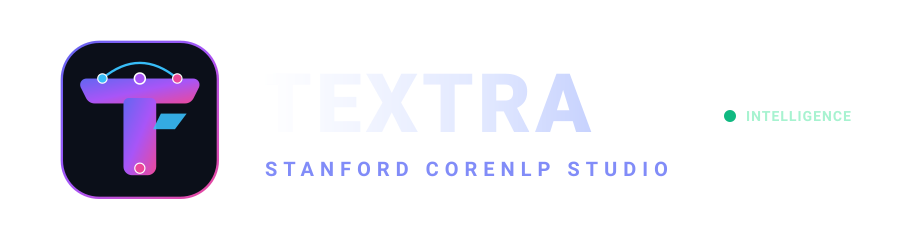
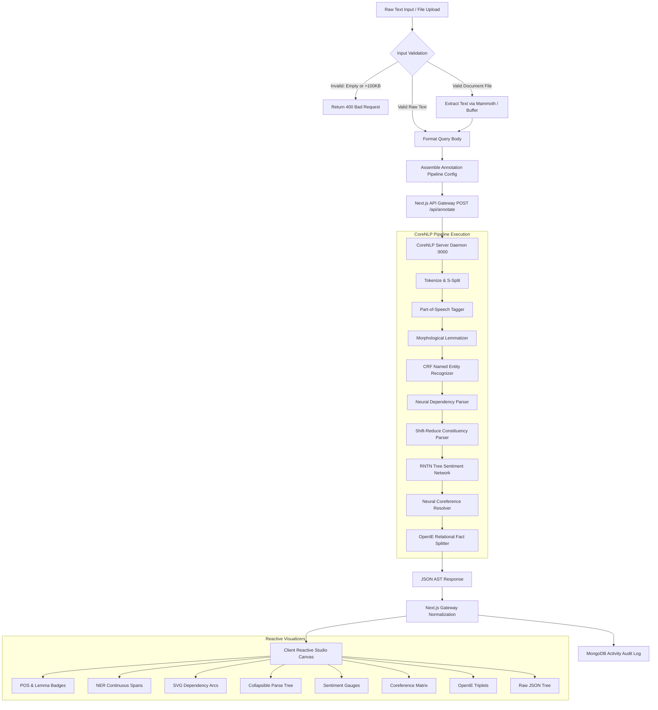
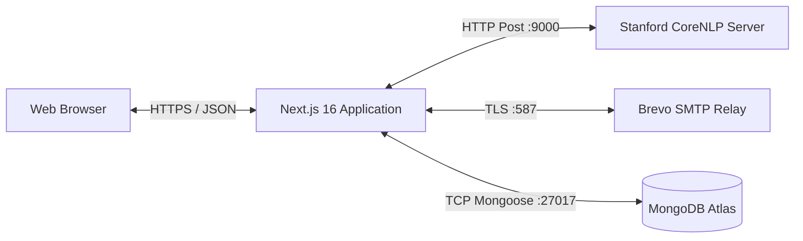
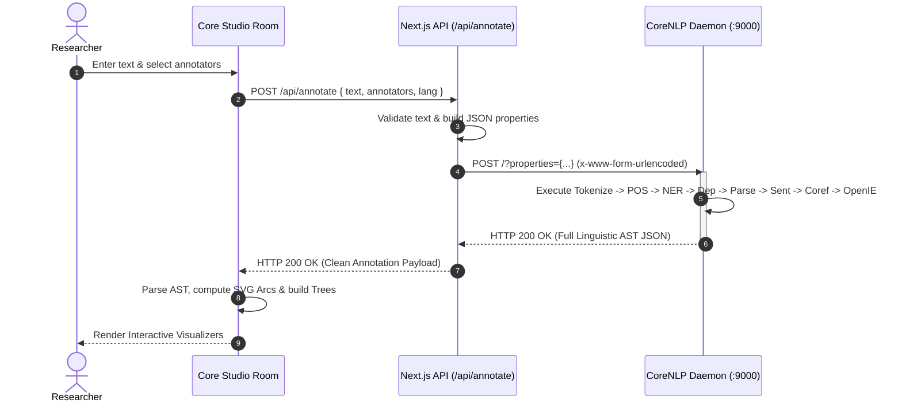
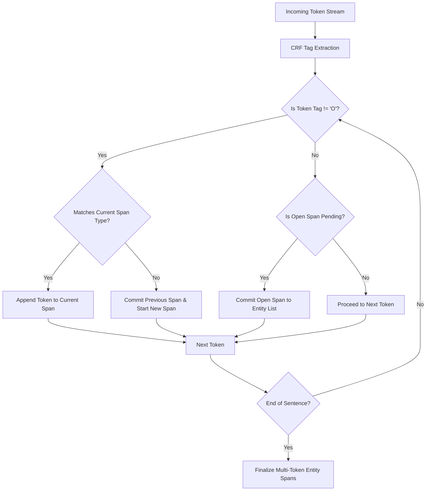
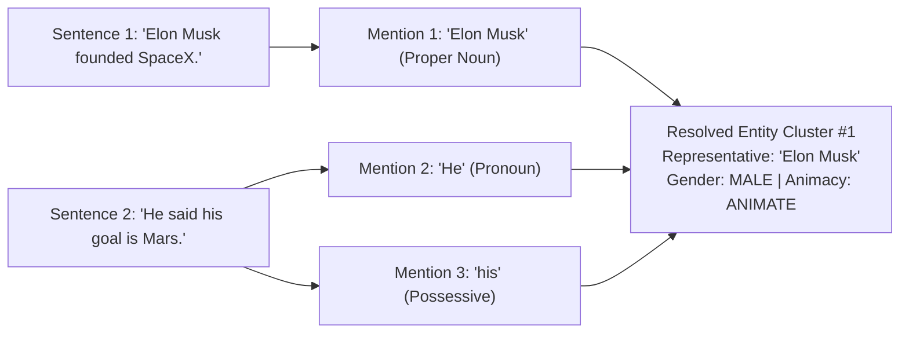
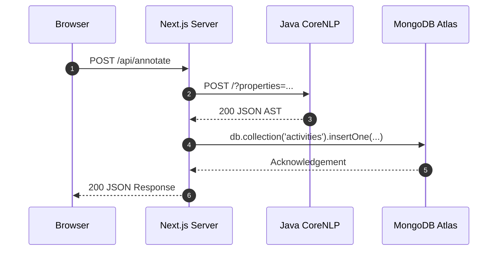
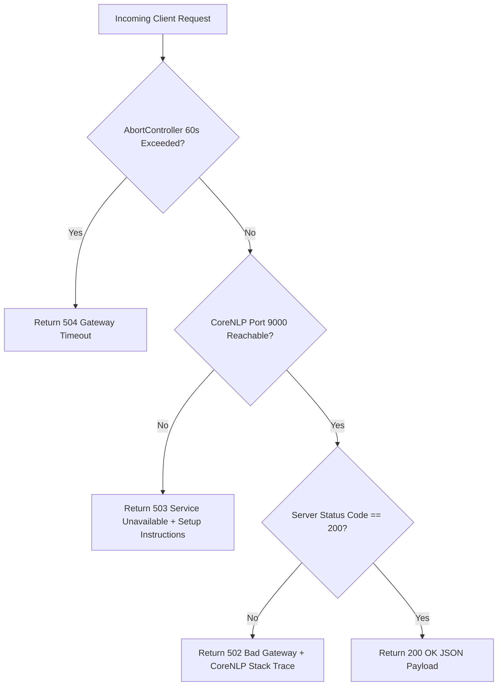

# Textra &mdash; Enterprise Natural Language Processing & Linguistic Intelligence Platform

<p align="center">
  
</p>

<p align="center">
  <strong>A full-spectrum, reactive computational linguistics platform integrating Stanford CoreNLP neural architectures with a high-performance Next.js 16 application, interactive reactive SVG visualizers, MongoDB persistence, and transactional email verification.</strong>
</p>

<p align="center">
  <a href="https://nextjs.org/"></a>
  <a href="https://react.dev/"></a>
  <a href="https://www.typescriptlang.org/"></a>
  <a href="https://stanfordnlp.github.io/CoreNLP/"></a>
  <a href="https://www.java.com/"></a>
  <a href="https://www.mongodb.com/"></a>
  <a href="https://tailwindcss.com/"></a>
  <a href="https://www.brevo.com/"></a>
</p>

---

## Table of Contents

- [1. Executive Summary & Project Overview](#1-executive-summary--project-overview)
  - [1.1 What is Textra?](#11-what-is-textra)
  - [1.2 Problem Statement](#12-problem-statement)
  - [1.3 The Proposed Solution](#13-the-proposed-solution)
  - [1.4 Engineering & NLP Objectives](#14-engineering--nlp-objectives)
- [2. Feature Matrix & Implementation Status](#2-feature-matrix--implementation-status)
- [3. NLP Concepts & Theoretical Foundations](#3-nlp-concepts--theoretical-foundations)
  - [3.1 Sentence Segmentation & Tokenization](#31-sentence-segmentation--tokenization)
  - [3.2 Lemmatization vs. Stemming](#32-lemmatization-vs-stemming)
  - [3.3 Part-of-Speech (POS) Tagging & Morphosyntax](#33-part-of-speech-pos-tagging--morphosyntax)
  - [3.4 Named Entity Recognition (NER) & Sequence Labeling](#34-named-entity-recognition-ner--sequence-labeling)
  - [3.5 Constituency Parsing & Phrase Structure Grammars](#35-constituency-parsing--phrase-structure-grammars)
  - [3.6 Universal Dependency Parsing (Basic & Enhanced++)](#36-universal-dependency-parsing-basic--enhanced)
  - [3.7 Deep Recursive Sentiment Analysis (RNTN)](#37-deep-recursive-sentiment-analysis-rntn)
  - [3.8 Coreference Resolution & Anaphoric Chains](#38-coreference-resolution--anaphoric-chains)
  - [3.9 Open Information Extraction (Open IE) & Knowledge Base Population](#39-open-information-extraction-open-ie--knowledge-base-population)
- [4. Comprehensive Linguistic Annotation Reference](#4-comprehensive-linguistic-annotation-reference)
  - [4.1 Terminological Taxonomy](#41-terminological-taxonomy)
  - [4.2 Lexical & Part-of-Speech Annotations (Penn Treebank)](#42-lexical--part-of-speech-annotations-penn-treebank)
  - [4.3 Named Entity Recognition Annotations](#43-named-entity-recognition-annotations)
  - [4.4 Universal Grammatical Dependency Relations](#44-universal-grammatical-dependency-relations)
  - [4.5 Compositional Sentiment Polarity](#45-compositional-sentiment-polarity)
  - [4.6 Coreference Cluster Mentions](#46-coreference-cluster-mentions)
  - [4.7 Open IE Semantic Triplets](#47-open-ie-semantic-triplets)
- [5. System Architecture](#5-system-architecture)
  - [5.1 High-Level Architecture Diagram](#51-high-level-architecture-diagram)
  - [5.2 Architectural Layers & Component Responsibilities](#52-architectural-layers--component-responsibilities)
  - [5.3 Complete Technology Stack](#53-complete-technology-stack)
  - [5.4 Architectural Decisions & Technical Trade-offs](#54-architectural-decisions--technical-trade-offs)
- [6. End-to-End Data Processing Pipeline](#6-end-to-end-data-processing-pipeline)
  - [6.1 Processing Lifecycle Flowchart](#61-processing-lifecycle-flowchart)
  - [6.2 Stage-by-Stage Execution Breakdown](#62-stage-by-stage-execution-breakdown)
  - [6.3 Concrete Input-to-Output Lifecycle Trace](#63-concrete-input-to-output-lifecycle-trace)
- [7. Detailed Feature Documentation](#7-detailed-feature-documentation)
  - [7.1 Core Studio Room & Multi-Annotator Execution](#71-core-studio-room--multi-annotator-execution)
  - [7.2 Interactive SVG Arc Dependency Visualizer](#72-interactive-svg-arc-dependency-visualizer)
  - [7.3 Hierarchical Constituency Parse Tree Explorer](#73-hierarchical-constituency-parse-tree-explorer)
  - [7.4 Continuous Entity Span Clusterer & NER Inspector](#74-continuous-entity-span-clusterer--ner-inspector)
  - [7.5 Part-of-Speech & Lemma Filter Canvas](#75-part-of-speech--lemma-filter-canvas)
  - [7.6 Compositional Sentiment & Polarity Distribution Gauge](#76-compositional-sentiment--polarity-distribution-gauge)
  - [7.7 Multi-Mention Coreference Cluster Resolver](#77-multi-mention-coreference-cluster-resolver)
  - [7.8 Open IE Semantic Fact & Assertion Harvester](#78-open-ie-semantic-fact--assertion-harvester)
  - [7.9 Multi-Format Document Ingestion Engine (.docx, .txt, .md, .csv)](#79-multi-format-document-ingestion-engine-docx-txt-md-csv)
  - [7.10 Dynamic Analytics Dashboard & User Activity Tracker](#710-dynamic-analytics-dashboard--user-activity-tracker)
  - [7.11 User Profile, Engine Control & Live Diagnostic Ping](#711-user-profile-engine-control--live-diagnostic-ping)
  - [7.12 Social OAuth & Brevo Transactional Email Verification Engine](#712-social-oauth--brevo-transactional-email-verification-engine)
- [8. System Workflow & Sequence Diagrams](#8-system-workflow--sequence-diagrams)
  - [8.1 High-Level Component Topology](#81-high-level-component-topology)
  - [8.2 CoreNLP Annotation Pipeline Execution](#82-corenlp-annotation-pipeline-execution)
  - [8.3 Named Entity Recognition & Continuous Span Grouping](#83-named-entity-recognition--continuous-span-grouping)
  - [8.4 Coreference Entity Resolution & Cross-Sentence Chain Linking](#84-coreference-entity-resolution--cross-sentence-chain-linking)
  - [8.5 End-to-End API Request & Database Persistence Sequence](#85-end-to-end-api-request--database-persistence-sequence)
  - [8.6 Error Handling, Timeouts & Fault-Tolerance Workflow](#86-error-handling-timeouts--fault-tolerance-workflow)
- [9. Complete API Reference](#9-complete-api-reference)
  - [9.1 POST /api/annotate](#91-post-apiannotate)
  - [9.2 POST /api/extract](#92-post-apiextract)
  - [9.3 GET /api/status](#93-get-apistatus)
  - [9.4 POST /api/auth/send-verification](#94-post-apiauthsend-verification)
  - [9.5 POST /api/auth/verify-otp](#95-post-apiauthverify-otp)
  - [9.6 POST /api/auth/forgot-password](#96-post-apiauthforgot-password)
- [10. Installation & Local Development](#10-installation--local-development)
  - [10.1 System Prerequisites](#101-system-prerequisites)
  - [10.2 Repository Setup & Installation](#102-repository-setup--installation)
  - [10.3 Stanford CoreNLP Server Setup](#103-stanford-corenlp-server-setup)
  - [10.4 Environment Configuration (.env.local)](#104-environment-configuration-envlocal)
  - [10.5 Launching the Development Server](#105-launching-the-development-server)
  - [10.6 Production Compilation & Execution](#106-production-compilation--execution)
  - [10.7 Comprehensive Troubleshooting Matrix](#107-comprehensive-troubleshooting-matrix)
- [11. Verification & Quality Assurance](#11-verification--quality-assurance)
- [12. Performance, Scalability & Engineering Considerations](#12-performance-scalability--engineering-considerations)
- [13. Security & Safe Data Handling](#13-security--safe-data-handling)
- [14. Real-World Applications](#14-real-world-applications)
- [15. Current Limitations & Technical Roadmap](#15-current-limitations--technical-roadmap)
- [16. Contributing Guidelines](#16-contributing-guidelines)
- [17. Frequently Asked Questions (FAQ)](#17-frequently-asked-questions-faq)
- [18. References, Research Citations & Acknowledgments](#18-references-research-citations--acknowledgments)
- [19. License & Project Metadata](#19-license--project-metadata)

---

## 1. Executive Summary & Project Overview

### 1.1 What is Textra?

**Textra** is an enterprise-grade computational linguistics and natural language intelligence platform. It bridges the gap between raw statistical NLP research architectures and modern web applications. Textra wraps the **Stanford CoreNLP Java 17 framework** into an intuitive, reactive, and visually communicative suite built on **Next.js 16 (Turbopack)**, **React 19**, **Tailwind CSS v4**, **Recharts**, and **MongoDB Atlas**.

Textra ingests raw unstructured human language (via direct user input or multi-format file uploads such as `.docx`, `.txt`, `.md`, and `.csv`) and transforms it into eight distinct layers of structured linguistic representations:
1. **Morphological Tokenization & Lemmatization**
2. **Penn Treebank Part-of-Speech Tagging**
3. **Named Entity Recognition & Sequence Extraction**
4. **Universal Dependency Arc Graphs (Basic & Enhanced++)**
5. **Hierarchical Constituency Parse Trees**
6. **Deep Recursive Neural Sentiment Analysis**
7. **Cross-Sentence Coreference Resolution Chains**
8. **Open Information Extraction (Open IE) Relational Triplets**

### 1.2 Problem Statement

Natural human language is fundamentally unstructured, context-dependent, grammatically ambiguous, and syntactically complex. Organizations, researchers, and engineers face severe challenges when extracting actionable intelligence from text:
- **Pipeline Fragmentation**: Traditional NLP workflows require chaining disparate command-line tools, Python scripts, and legacy Java binaries, creating brittle deployment environments.
- **Opaque Representations**: Standard NLP pipelines output dense, multi-megabyte JSON payloads that make visual inspection of syntactic dependencies, entity coreference, and phrase trees difficult.
- **Lack of Integrated Monitoring**: Most academic NLP engines lack authentication, session tracking, ingestion analytics, database persistence, and document upload capabilities.
- **Syntactic Ambiguity**: Words possess shifting grammatical categories depending on clausal context (e.g., *"run"* as a noun vs. verb). Without full syntactic parsing, downstream extraction systems fail.

### 1.3 The Proposed Solution

Textra solves these problems through a unified full-stack architecture:

```
[ Unstructured Documents / Text ]
               │
               ▼
┌────────────────────────────────────────┐
│     Next.js 16 Edge / Server Tier      │  <── Auth, Brevo SMTP, MongoDB Atlas
│   (Validation, Multipart Extraction)   │
└──────────────────┬─────────────────────┘
                   │ HTTP JSON Proxy (Port 9000)
                   ▼
┌────────────────────────────────────────┐
│   Stanford CoreNLP Engine (Java 17)    │  <── 4GB Heap (-Xmx4g), Neural Models
│ (POS, NER, Trees, Sentiment, Coref)    │
└──────────────────┬─────────────────────┘
                   │ Structured AST / Annotations
                   ▼
┌────────────────────────────────────────┐
│    Reactive Studio & Visual Canvas     │  <── SVG Arcs, Tree Graphs, Donut Charts
│   (Core Studio, Dashboard, Profile)    │
└────────────────────────────────────────┘
```

1. **Native Pipeline Orchestration**: A Next.js API gateway communicates directly with a long-running, multithreaded Stanford CoreNLP server instance on port `9000`.
2. **Reactive Visualizers**: Instead of static text dumps, Textra computes dynamic SVG arc trajectories, interactive hierarchical collapsible parse trees, color-coded entity span groupers, and real-time sentiment distribution gauges.
3. **Document Ingestion**: Seamless ingestion of Word documents (`.docx`), Markdown (`.md`), plain text (`.txt`), and CSVs (`.csv`) with automatic word and character counting.
4. **Data Persistence**: Automatic logging of user activities, tokens analyzed, latency metrics, and verification tokens to a cloud-hosted MongoDB Atlas cluster.
5. **Security & Authentication**: Brevo (Sendinblue) transactional SMTP relay for 6-digit OTP verification, alongside Google, GitHub, and LinkedIn OAuth integration.

### 1.4 Engineering & NLP Objectives

- **Linguistic Precision**: Retain 100% fidelity to the Stanford Penn Treebank and Universal Dependencies v2 specifications.
- **Sub-Second Processing**: Provide low-latency annotation pipelines (&lt;350ms average turnaround for standard paragraphs).
- **Fault Tolerance**: Implement graceful degradation, model fallbacks (such as rule-based clause splitting when optional OpenIE models are absent), and automated health pings.
- **Zero-Dependency Quickstart**: Support an in-memory simulation mode with a demo master OTP (`123456`) so that the application runs immediately before external environment variables are configured.

---

## 2. Feature Matrix & Implementation Status

| Feature / Capability | Implementation Module | Technical Implementation | Status |
| :--- | :--- | :--- | :---: |
| **Tokenization & Sentence Splitting** | `src/app/api/annotate/route.ts` | Stanford PTBTokenizer & Rule-based SentenceSplitter | **Fully Implemented** |
| **Penn Treebank POS Tagging** | `src/components/studio/PosVisualizer.tsx` | MaxEnt / Left3Words Morphological Model (36 Tags) | **Fully Implemented** |
| **Base Lemma Extraction** | `src/components/studio/PosVisualizer.tsx` | Morphology & Dictionary Lemmatizer | **Fully Implemented** |
| **Named Entity Recognition (NER)** | `src/components/studio/NerVisualizer.tsx` | CRF Sequence Labeler (13 Entity Classes + Spans) | **Fully Implemented** |
| **Universal Dependency Parsing** | `src/components/studio/DependencyVisualizer.tsx` | Neural Dependency Parser + Custom SVG Arc Renderer | **Fully Implemented** |
| **Enhanced++ Dependencies** | `src/components/studio/DependencyVisualizer.tsx` | Universal Dependencies v2 Enhanced Representation | **Fully Implemented** |
| **Constituency Parse Trees** | `src/components/studio/ParseTreeVisualizer.tsx` | Shift-Reduce Parser + S-Expression Bracket Parser | **Fully Implemented** |
| **Recursive Sentiment Analysis** | `src/components/studio/SentimentVisualizer.tsx` | 5-Class Recursive Neural Tensor Network (RNTN) | **Fully Implemented** |
| **Coreference Resolution** | `src/components/studio/CorefVisualizer.tsx` | Neural Mention Ranking & Antecedent Clusterer | **Fully Implemented** |
| **Open Information Extraction** | `src/components/studio/OpenIeVisualizer.tsx` | OpenIE 5 / KBP Clause Relational Triplet Extractor | **Fully Implemented** |
| **Raw JSON Inspector** | `src/components/studio/JsonViewer.tsx` | Formatted AST JSON Viewer with Clipboard & Search | **Fully Implemented** |
| **Document File Ingestion** | `src/app/api/extract/route.ts` | Mammoth (.docx) + Buffer Parser (.txt, .md, .csv) | **Fully Implemented** |
| **CoreNLP Health Diagnostics** | `src/app/api/status/route.ts` | Latency / Ping Monitor to Port 9000 Daemon | **Fully Implemented** |
| **Interactive Landing Page** | `src/app/page.tsx` | Hero Banner, Live Demo Sandbox, Capabilities Grid | **Fully Implemented** |
| **Dynamic Analytics Dashboard** | `src/app/dashboard/page.tsx` | Recharts Line/Area, Donut, Bar Charts, CSV Export | **Fully Implemented** |
| **User Profile Management** | `src/app/profile/page.tsx` | 5 Tabs: Profile, Social, CoreNLP Controls, Brevo, Security | **Fully Implemented** |
| **MongoDB Atlas Persistence** | `src/lib/mongodb.ts`, `src/lib/dbService.ts` | MongoDB Connection Pool, Users, OTPs, Activities | **Fully Implemented** |
| **Brevo SMTP Verification** | `src/lib/email.ts`, `src/app/auth/verify/page.tsx` | Nodemailer + Brevo SMTP Relay (Port 587) + OTP Flow | **Fully Implemented** |
| **Social OAuth Integration** | `src/app/auth/login/page.tsx`, `signup/page.tsx` | Google, GitHub, LinkedIn Auth Buttons & Callbacks | **Fully Implemented** |
| **Custom Vector Branding** | `public/logo.svg`, `public/textra-logo-full.svg` | Modern Vector Emblems & Typographic Marks | **Fully Implemented** |

---

## 3. NLP Concepts & Theoretical Foundations

### 3.1 Sentence Segmentation & Tokenization
- **Definition**: The fundamental decomposition of a continuous stream of characters into discrete syntactic units (*tokens*) and bounded propositions (*sentences*).
- **Theoretical Basis**: While whitespace splitting works naively for English, linguistic tokenization must handle abbreviations (*"U.S.A."*), clitics (*"don't"* &rarr; *"do"*, *"n't"*), contractions, numerical expressions (*"1,000.50"*), and punctuation boundaries.
- **Textra Implementation**: Textra triggers Stanford's `tokenize` and `ssplit` annotators, which utilize finite-state rule sets tuned to the Penn Treebank standard, returning exact character offsets (`characterOffsetBegin`, `characterOffsetEnd`).

### 3.2 Lemmatization vs. Stemming
- **Definition**: Reducing inflectional forms of a word to its canonical base or dictionary form (*lemma*).
- **Difference from Stemming**: Stemming uses crude heuristic suffix stripping (e.g., Porter Stemmer converting *"running"* to *"run"*, but *"better"* to *"better"*). Lemmatization uses full morphological analysis backed by vocabulary knowledge (e.g., converting *"was"* &rarr; *"be"*, *"better"* &rarr; *"good"*, *"corpora"* &rarr; *"corpus"*).
- **Textra Implementation**: The `lemma` annotator inspects token text alongside its assigned POS tag to produce morphologically accurate lemmas.

### 3.3 Part-of-Speech (POS) Tagging & Morphosyntax
- **Definition**: Assigning grammatical categories (Noun, Verb, Adjective, Determiner, etc.) to each token based on both its definition and its context within the sentence.
- **Theoretical Basis**: Textra uses the 36-tag **Penn Treebank POS tagset**. This allows the pipeline to disambiguate identical words that play different syntactic roles (e.g., *"book a flight"* &rarr; `VB` vs. *"read a book"* &rarr; `NN`).
- **Textra Implementation**: Powered by a Maximum Entropy (MaxEnt) / bidirectional left3words model (`english-left3words-distsim.tagger`), color-coded and filterable by grammatical class in the UI.

### 3.4 Named Entity Recognition (NER) & Sequence Labeling
- **Definition**: Locating and classifying unstructured token sequences into predefined semantic categories (e.g., individuals, organizations, geographical locations, numerical metrics, temporal expressions).
- **Theoretical Basis**: Formulated as a sequence tagging problem using Conditional Random Fields (CRF) and regular-expression patterns (`RegexNER`).
- **Textra Implementation**: Supports 13 entity classes: `PERSON`, `ORGANIZATION`, `LOCATION`, `DATE`, `TIME`, `MONEY`, `PERCENT`, `DURATION`, `CITY`, `COUNTRY`, `STATE_OR_PROVINCE`, `NATIONALITY`, and `MISC`. Consecutive tokens sharing an identical entity tag are automatically coalesced into unified multi-word spans.

### 3.5 Constituency Parsing & Phrase Structure Grammars
- **Definition**: Modeling the hierarchical nested phrase structure of sentences according to context-free phrase structure grammars (CFGs).
- **Theoretical Basis**: Demonstrates how words group into constituents (Noun Phrases `NP`, Verb Phrases `VP`, Prepositional Phrases `PP`) that combine to form sentences `S`.
- **Textra Implementation**: Textra uses Stanford's Shift-Reduce constituent parser, serializing trees into Penn Treebank bracket expressions (e.g., `(ROOT (S (NP ...) (VP ...)))`), which are parsed into an interactive nested collapsible tree explorer by `src/lib/parseTree.ts`.

### 3.6 Universal Dependency Parsing (Basic & Enhanced++)
- **Definition**: Directly mapping binary grammatical relations between head words (*governors*) and their modifiers (*dependents*).
- **Theoretical Basis**: Unlike phrase structure, dependency syntax does not use constituent non-terminals. It connects words via typed relations (e.g., `nsubj` nominal subject, `obj` direct object, `amod` adjectival modifier).
- **Textra Implementation**: Implements **Universal Dependencies v2 (UD)**. Textra supports both **Basic Dependencies** (tree-structured, exactly one head per word) and **Enhanced++ Dependencies** (graph-structured, supporting shared arguments in control and coordination structures). Rendered using custom SVG bezier arcs.

### 3.7 Deep Recursive Sentiment Analysis (RNTN)
- **Definition**: Computing emotional polarity (from Very Negative to Very Positive) over syntactic parse trees.
- **Theoretical Basis**: Bag-of-words sentiment models fail on complex negation (e.g., *"not bad"*, *"an entertaining movie that fails to impress"*). Stanford's **Recursive Neural Tensor Network (RNTN)** computes compositional vectors bottom-up through the constituency tree, capturing how negation and qualification change phrase meaning.
- **Textra Implementation**: Outputs a 5-class probability distribution array (`sentimentDistribution`) across `Very Negative` (0), `Negative` (1), `Neutral` (2), `Positive` (3), and `Very Positive` (4).

### 3.8 Coreference Resolution & Anaphoric Chains
- **Definition**: Determining when different mentions across sentences refer to the same real-world entity (e.g., connecting *"Elon Musk"*, *"He"*, and *"his"* in a paragraph).
- **Theoretical Basis**: Uses neural mention detection and pairwise ranking algorithms to group nominal, proper, and pronominal mentions into cluster graphs.
- **Textra Implementation**: Identified mentions receive detailed attributes: `text`, `type`, `number` (singular/plural), `gender` (MALE, FEMALE, UNKNOWN), `animacy` (ANIMATE, INANIMATE), `startIndex`, `endIndex`, and a boolean flag designating the **representative mention**.

### 3.9 Open Information Extraction (Open IE) & Knowledge Base Population
- **Definition**: Extracting open-domain, structured relational facts without predefined schemas, formatted as `(Subject, Relation, Object)` triplets.
- **Theoretical Basis**: Analyzes dependency paths and clausal splitters to transform complex sentences into elementary relational propositions.
- **Textra Implementation**: The `openie` and `kbp` annotators extract subject-predicate-object assertions. Textra includes an automated fallback (`openie.splitter.nomodel=true`) that enables rule-based clause splitting even when heavy external clause searcher models are omitted.

---

## 4. Comprehensive Linguistic Annotation Reference

### 4.1 Terminological Taxonomy

Understanding the difference between core linguistic metadata types is essential:

```
┌──────────────────────────────────────────────────────────────────────────────┐
│ LINGUISTIC TAXONOMY                                                          │
├─────────────────┬────────────────────────────────────────────────────────────┤
│ Term            │ Formal Definition                                          │
├─────────────────┼────────────────────────────────────────────────────────────┤
│ Token           │ The discrete character span representing a single word,    │
│                 │ number, or punctuation mark.                               │
│ Label           │ A categorical tag assigned to a token (e.g., POS: NNP).     │
│ Lemma           │ The dictionary / canonical base form of an inflected word. │
│ Entity          │ The real-world referent denoted by an expression.          │
│ Entity Mention  │ A specific token span in text referring to an entity.      │
│ Reference Chain │ The cluster of all mentions referring to the same entity.  │
│ Linguistic Arc  │ A directed typed dependency linking governor to dependent. │
│ Parse Constituent│ A complete phrasal subtree (NP, VP, PP) in a CFG tree.    │
└─────────────────┴────────────────────────────────────────────────────────────┘
```

### 4.2 Lexical & Part-of-Speech Annotations (Penn Treebank)

Textra implements the complete 36-tag Penn Treebank POS specification:

<details open>
<summary><strong>View Supported Penn Treebank POS Tags</strong></summary>

| POS Tag | Grammatical Description | Broad Category | Example Token | Color Group |
| :--- | :--- | :--- | :--- | :--- |
| `NN` | Noun, singular or mass | Noun | *table, algorithm, water* | Blue |
| `NNS` | Noun, plural | Noun | *models, servers, trees* | Blue |
| `NNP` | Proper noun, singular | Noun | *Stanford, Google, California* | Indigo |
| `NNPS` | Proper noun, plural | Noun | *Americans, Carolinas* | Indigo |
| `VB` | Verb, base form | Verb | *analyze, parse, run* | Emerald |
| `VBD` | Verb, past tense | Verb | *founded, developed, built* | Emerald |
| `VBG` | Verb, gerund / present participle | Verb | *processing, computing* | Emerald |
| `VBN` | Verb, past participle | Verb | *evaluated, trained* | Emerald |
| `VBP` | Verb, non-3rd person singular present | Verb | *read, ingest, write* | Emerald |
| `VBZ` | Verb, 3rd person singular present | Verb | *analyzes, parses, outputs* | Emerald |
| `MD` | Modal auxiliary | Verb | *can, should, will, must* | Teal |
| `JJ` | Adjective | Adjective | *neural, syntactic, rapid* | Amber |
| `JJR` | Adjective, comparative | Adjective | *faster, larger, better* | Amber |
| `JJS` | Adjective, superlative | Adjective | *fastest, highest, best* | Amber |
| `RB` | Adverb | Adverb | *accurately, deeply, quickly* | Orange |
| `RBR` | Adverb, comparative | Adverb | *faster, more reliably* | Orange |
| `RBS` | Adverb, superlative | Adverb | *most accurately* | Orange |
| `WRB` | Wh-adverb | Adverb | *where, when, how* | Orange |
| `PRP` | Personal pronoun | Pronoun | *he, she, it, they* | Purple |
| `PRP$` | Possessive pronoun | Pronoun | *his, her, their, its* | Purple |
| `WP` | Wh-pronoun | Pronoun | *who, what* | Purple |
| `WP$` | Possessive wh-pronoun | Pronoun | *whose* | Purple |
| `DT` | Determiner | Determiner | *the, a, this, every* | Cyan |
| `WDT` | Wh-determiner | Determiner | *which, whatever* | Cyan |
| `CD` | Cardinal number | Number | *1885, 42, 3.14* | Pink |
| `IN` | Preposition / subordinating conjunction | Preposition | *in, on, by, through, although*| Rose |
| `CC` | Coordinating conjunction | Conjunction | *and, or, but, yet* | Fuchsia |
| `TO` | Infinitive marker "to" | Particle | *to (run)* | Slate |
| `RP` | Phrasal verb particle | Particle | *up (give up), off* | Slate |
| `POS` | Possessive ending | Punctuation | *'s* | Gray |

</details>

### 4.3 Named Entity Recognition Annotations

<details open>
<summary><strong>View Supported Named Entity Recognition Tags</strong></summary>

| Entity Tag | Semantic Definition | Color Badge | Real-World Example |
| :--- | :--- | :--- | :--- |
| `PERSON` | Named individuals, human agents, historical figures | Rose (`#f43f5e`) | *Leland Stanford, Barack Obama* |
| `ORGANIZATION` | Companies, academic institutions, agencies, governing bodies | Blue (`#2563eb`) | *Stanford University, Google, DeepMind* |
| `LOCATION` | Geographical regions, bodies of water, monuments | Sky (`#0284c7`) | *California, Mount Everest, Silicon Valley* |
| `CITY` | Incorporated municipalities and cities | Cyan (`#06b6d4`) | *Mountain View, London, New York* |
| `STATE_OR_PROVINCE`| Administrative state, provincial, or territorial divisions | Cyan (`#0891b2`) | *California, Ontario, Bavaria* |
| `COUNTRY` | Sovereign nations and global states | Blue (`#1d4ed8`) | *United States, India, Germany* |
| `DATE` | Absolute and relative calendar dates and years | Emerald (`#10b981`) | *1885, November 16, yesterday* |
| `TIME` | Points in time, clock times, timestamp records | Teal (`#14b8a6`) | *10:30 AM, 14:00 UTC* |
| `MONEY` | Monetary values with associated currency units | Amber (`#f59e0b`) | *$100 million, €45, 5,000 Yen* |
| `PERCENT` | Percentages and fractional ratios | Orange (`#f97316`) | *99.2%, 15 percent* |
| `DURATION` | Lengths of time spans | Indigo (`#6366f1`) | *two weeks, 30 days, 4 years* |
| `NATIONALITY` | Ethno-national identifiers and affiliations | Violet (`#8b5cf6`) | *American, British, Japanese* |
| `MISC` | Miscellaneous named artifacts, events, treaties | Purple (`#a855f7`) | *World War II, Olympic Games* |

</details>

### 4.4 Universal Grammatical Dependency Relations

Textra renders Universal Dependencies v2 relations:

| Relation | Formal Linguistic Description | Example in Text |
| :--- | :--- | :--- |
| `root` | Root head of the entire sentence | *founded* in *"Stanford founded the university."* |
| `nsubj` | Nominal subject acting as the syntactic agent | *Leland* &larr; `nsubj` &larr; *founded* |
| `nsubj:pass`| Passive nominal subject receiving action | *University* &larr; `nsubj:pass` &larr; *was founded* |
| `obj` / `dobj`| Direct accusative object of the verb | *founded* &rarr; `obj` &rarr; *university* |
| `iobj` | Indirect object | *gave* &rarr; `iobj` &rarr; *him* |
| `csubj` | Clausal subject proposition | *What he said* &larr; `csubj` &larr; *surprised us* |
| `ccomp` | Clausal complement with internal subject | *He said* &rarr; `ccomp` &rarr; *that he was tired* |
| `xcomp` | Open clausal complement lacking subject | *hopes* &rarr; `xcomp` &rarr; *to succeed* |
| `obl` | Oblique argument or prepositional modifier | *founded* &rarr; `obl` &rarr; *in California* |
| `advmod` | Adverbial modifier modifying verbs or adjectives | *blazingly* &larr; `advmod` &larr; *fast* |
| `amod` | Adjectival modifier modifying a nominal head | *quantum* &larr; `amod` &larr; *processors* |
| `appos` | Appositional modifier specifying an entity | *Jane, his wife* |
| `nummod` | Numerical modifier modifying a noun | *1885* &larr; `nummod` &larr; *years* |
| `compound` | Compound noun or noun-noun sequence | *quantum* &larr; `compound` &larr; *supremacy* |
| `case` | Prepositional or postpositional case marker | *in* &larr; `case` &larr; *California* |
| `det` | Grammatical determiner or article | *the* &larr; `det` &larr; *processor* |
| `conj` | Conjunct linked by coordination | *Leland* &rarr; `conj` &rarr; *Jane* |
| `cc` | Coordinating conjunction | *and* &larr; `cc` &larr; *Jane* |
| `punct` | Terminal or phrase-internal punctuation | *.* &larr; `punct` &larr; *founded* |

---

## 5. System Architecture

### 5.1 High-Level Architecture Diagram

```mermaid
graph TD
  subgraph Client ["Client Presentation Tier (Browser)"]
    UI["Next.js 16 Web Application"]
    Landing["Landing Page (/)"]
    Studio["Core Studio Room (/studio)"]
    Dashboard["Analytics Dashboard (/dashboard)"]
    Profile["User Profile (/profile)"]
    Auth["Auth Pages (/auth/*)"]
  end

  subgraph Gateway ["Next.js 16 Server / API Gateway"]
    API_Annotate["POST /api/annotate"]
    API_Extract["POST /api/extract"]
    API_Status["GET /api/status"]
    API_Auth["POST /api/auth/*"]
    DB_Service["dbService.ts / email.ts"]
  end

  subgraph CoreNLP_Engine ["NLP Inference Daemon (Port 9000)"]
    JavaServer["StanfordCoreNLPServer (Java 17)"]
    ModelsJAR["stanford-corenlp-4.5.5-models.jar"]
    EnglishJAR["stanford-corenlp-4.5.5-models-english.jar"]
    P_Tokenize["Tokenizer & S-Splitter"]
    P_POS["MaxEnt POS Tagger"]
    P_NER["CRF NER & RegexNER"]
    P_Dep["Neural Dependency Parser"]
    P_Parse["Constituency Parser"]
    P_Sent["RNTN Sentiment Network"]
    P_Coref["Neural Mention Coreference"]
    P_OpenIE["OpenIE Relational Splitter"]
  end

  subgraph Persistence ["External Services & Storage"]
    MongoDB[("MongoDB Atlas Cloud DB<br/>users | otps | activities")]
    Brevo["Brevo (Sendinblue) SMTP Relay<br/>Port 587 TLS"]
  end

  UI --> Landing & Studio & Dashboard & Profile & Auth
  Studio -->|User Text / Presets| API_Annotate
  Studio -->|Upload .docx, .txt, .csv| API_Extract
  Dashboard -->|Activity Retrieval| DB_Service
  Profile -->|Health Ping| API_Status
  Auth -->|Verification / Pass Reset| API_Auth

  API_Annotate -->|HTTP POST Form (props JSON)| JavaServer
  API_Status -->|GET /ping| JavaServer
  API_Auth -->|Send OTP| Brevo
  API_Auth -->|Save OTP / User| MongoDB
  DB_Service -->|Log Activity| MongoDB

  JavaServer --> P_Tokenize --> P_POS --> P_NER --> P_Dep --> P_Parse --> P_Sent --> P_Coref --> P_OpenIE
  ModelsJAR -.-> JavaServer
  EnglishJAR -.-> JavaServer
```

### 5.2 Architectural Layers & Component Responsibilities

1. **Client Presentation Layer (React 19, Tailwind CSS v4, Lucide React)**:
   - Renders responsive interfaces across mobile and desktop.
   - Manages interactive state (token filtering, sentence switching, tree collapsing, zoom/pan).
   - Generates client-side SVG bezier curves for dependency arcs.
   - Renders animated Recharts data visualizations.
2. **API Gateway & Middleware Layer (Next.js 16 Route Handlers)**:
   - Enforces request validation, character length boundaries, and payload sanitization.
   - Constructs property parameters for Stanford CoreNLP.
   - Manages connection caching for MongoDB Atlas across serverless invocations.
   - Handles multi-format document text extraction using `mammoth`.
3. **NLP Inference Engine Layer (Stanford CoreNLP, Java 17 HotSpot)**:
   - Executes heavy neural inference in a separate, dedicated JVM process with 4GB heap allocation (`-Xmx4g`).
   - Runs multithreaded pipelines across 12 worker threads for rapid sentence-level parsing.
4. **Data Persistence & Integration Layer (MongoDB Atlas & Brevo SMTP)**:
   - Persists user credentials, verification tokens, and analysis logs.
   - Dispatches transactional emails via Brevo SMTP relay (`smtp-relay.brevo.com:587`).

### 5.3 Complete Technology Stack

| Category | Technology | Version | Purpose in Textra |
| :--- | :--- | :--- | :--- |
| **Frontend Framework** | Next.js | `16.4.6` | App Router, SSR, Turbopack, client & server components |
| **UI Library** | React | `19.3.0` | Declarative reactive component tree |
| **Type System** | TypeScript | `5.0+` | End-to-end static typing and interfaces |
| **CSS Framework** | Tailwind CSS | `4.3.3` | Utility-first styling, dark mode, responsive design |
| **Data Visualization** | Recharts | `3.10.1` | Line/Area charts, Donut charts, Bar charts |
| **NLP Engine** | Stanford CoreNLP | `4.5.5` | Core pipeline annotators and linguistic parsing |
| **Runtime (Java)** | OpenJDK HotSpot | `17.0.16.8` | High-performance JVM for CoreNLP execution |
| **Database** | MongoDB Atlas | `v6.x` | Cloud document persistence for users, OTPs, and logs |
| **Database Driver** | MongoDB Node Driver | `6.13.0` | Connection pool caching and document queries |
| **Email Protocol** | Nodemailer | `10.5.0` | SMTP client communicating with Brevo Relay |
| **Email Provider** | Brevo (Sendinblue) | SMTP v3 | Transactional OTP delivery and verification codes |
| **Docx Parser** | Mammoth.js | `1.13.0` | Raw text extraction from `.docx` documents |
| **Icons** | Lucide React | `1.73.0` | Scalable interface iconography |

### 5.4 Architectural Decisions & Technical Trade-offs

#### Decision 1: Dedicated Java 17 Daemon vs. In-Process Node.js Bindings
- **Chosen**: Stanford CoreNLP running as an independent HTTP server process on port `9000`.
- **Trade-off**: Requires running two processes (Java + Next.js).
- **Justification**: Java in-process bindings (`node-java`) require complex native C++ toolchain compilation (node-gyp) that frequently breaks across Node versions and operating systems. Running a dedicated daemon isolates memory heap crashes from the web frontend, allows independent heap scaling (`-Xmx4g`), and leverages Stanford's native multithreaded HTTP server.

#### Decision 2: MongoDB Atlas vs. Relational SQL
- **Chosen**: MongoDB Atlas document store.
- **Trade-off**: Lacks strict relational foreign key constraints.
- **Justification**: CoreNLP outputs deeply nested hierarchical JSON data structures (sentences &rarr; tokens, parse trees, dependency arrays, coreference mention matrices). A document store represents these structures naturally without multi-table SQL joins or complex database migrations.

#### Decision 3: Custom SVG Arc Visualizer vs. Third-Party Brat Embedding
- **Chosen**: Handcrafted React SVG Arc Component (`DependencyVisualizer.tsx`).
- **Trade-off**: Required implementing bezier curve coordinate calculations and layout mathematics.
- **Justification**: Embedded Brat visualizers rely on legacy jQuery and Quirks Mode DOM manipulation from 2012, conflicting with React 19's virtual DOM. Our custom SVG engine is lightweight, reactive, theme-aware, and responsive.

---

## 6. End-to-End Data Processing Pipeline

### 6.1 Processing Lifecycle Flowchart



### 6.2 Stage-by-Stage Execution Breakdown

1. **Ingestion & Validation**: Text is entered in the studio or imported via drag-and-drop. In the case of `.docx` files, Mammoth unpacks the XML document structure into raw string text.
2. **Gateway Encoding**: `POST /api/annotate` encodes properties as a JSON string, appends `pipelineLanguage=en`, sets a 60-second abort controller, and streams the body via `application/x-www-form-urlencoded;charset=UTF-8` to port `9000`.
3. **CoreNLP Execution**: Stanford CoreNLP processes the text sequentially across the chosen annotators.
4. **Tree Parsing & Structure Extraction**: The Next.js frontend receives the JSON AST. `parsePennTreebank` converts the raw bracketed string into recursive node objects.
5. **Continuous Entity Grouping**: Consecutive tokens tagged with matching NER labels are consolidated into multi-token entity spans.
6. **Persistence & UI Render**: MongoDB logs the activity record, and the UI activates all eight reactive visualizer tabs.

### 6.3 Concrete Input-to-Output Lifecycle Trace

**Input Text**:
> *"Stanford University was founded in 1885 by Leland Stanford."*

<details>
<summary><strong>View Transformed Structured JSON Representation</strong></summary>

```json
{
  "sentences": [
    {
      "index": 0,
      "sentiment": "Neutral",
      "sentimentValue": "2",
      "tokens": [
        { "index": 1, "word": "Stanford", "lemma": "Stanford", "pos": "NNP", "ner": "ORGANIZATION" },
        { "index": 2, "word": "University", "lemma": "University", "pos": "NNP", "ner": "ORGANIZATION" },
        { "index": 3, "word": "was", "lemma": "be", "pos": "VBD", "ner": "O" },
        { "index": 4, "word": "founded", "lemma": "found", "pos": "VBN", "ner": "O" },
        { "index": 5, "word": "in", "lemma": "in", "pos": "IN", "ner": "O" },
        { "index": 6, "word": "1885", "lemma": "1885", "pos": "CD", "ner": "DATE" },
        { "index": 7, "word": "by", "lemma": "by", "pos": "IN", "ner": "O" },
        { "index": 8, "word": "Leland", "lemma": "Leland", "pos": "NNP", "ner": "PERSON" },
        { "index": 9, "word": "Stanford", "lemma": "Stanford", "pos": "NNP", "ner": "PERSON" },
        { "index": 10, "word": ".", "lemma": ".", "pos": ".", "ner": "O" }
      ],
      "basicDependencies": [
        { "dep": "ROOT", "governor": 0, "dependent": 4 },
        { "dep": "nsubj:pass", "governor": 4, "dependent": 2 },
        { "dep": "compound", "governor": 2, "dependent": 1 },
        { "dep": "aux:pass", "governor": 4, "dependent": 3 },
        { "dep": "obl", "governor": 4, "dependent": 6 },
        { "dep": "case", "governor": 6, "dependent": 5 },
        { "dep": "obl:agent", "governor": 4, "dependent": 9 },
        { "dep": "case", "governor": 9, "dependent": 7 },
        { "dep": "compound", "governor": 9, "dependent": 8 }
      ],
      "openie": [
        {
          "subject": "Leland Stanford",
          "relation": "founded",
          "object": "Stanford University"
        }
      ]
    }
  ]
}
```

</details>

---

## 7. Detailed Feature Documentation

### 7.1 Core Studio Room & Multi-Annotator Execution
- **Source Module**: `src/app/studio/page.tsx`, `src/components/studio/TextInput.tsx`
- **Capabilities**:
  - Checkbox toggles for all eight annotator phases.
  - One-click *Select All* and *Reset* shortcuts.
  - Five pre-loaded benchmark sample texts.
  - Live character and word count statistics.
  - Multi-tab visualization canvas with state persistence.

### 7.2 Interactive SVG Arc Dependency Visualizer
- **Source Module**: `src/components/studio/DependencyVisualizer.tsx`
- **Capabilities**:
  - Computes cubic bezier curves (`M startX,Y C cp1X,cp1Y cp2X,cp2Y endX,Y`) dynamically scaled by token distance.
  - Toggle between **Basic Universal Dependencies** and **Enhanced++ Dependencies**.
  - Interactive token highlighting: hovering over any token illuminates its inbound and outbound dependency arcs while dimming unrelated links.
  - Multi-sentence selector tabs for multi-sentence documents.

### 7.3 Hierarchical Constituency Parse Tree Explorer
- **Source Module**: `src/components/studio/ParseTreeVisualizer.tsx`, `src/lib/parseTree.ts`
- **Capabilities**:
  - Transforms Penn Treebank bracket expressions into interactive tree graphs.
  - Collapsible nodes: click on any non-terminal constituent (`S`, `NP`, `VP`) to collapse or expand subtrees.
  - Depth-based color gradients highlighting syntactic structural hierarchy.
  - Terminal leaf tags showing word-level lexical assignments.

### 7.4 Continuous Entity Span Clusterer & NER Inspector
- **Source Module**: `src/components/studio/NerVisualizer.tsx`
- **Capabilities**:
  - Automatically merges contiguous tokens sharing the same entity tag into multi-token entities (e.g., combining `Leland` and `Stanford` into `Leland Stanford` [PERSON]).
  - Category filter pills (`ALL`, `PERSON`, `ORGANIZATION`, `LOCATION`, `DATE`, `MONEY`, `PERCENT`).
  - Entity occurrence frequency counter.
  - In-context inline entity view displaying highlighted text with color-coded semantic badges.

### 7.5 Part-of-Speech & Lemma Filter Canvas
- **Source Module**: `src/components/studio/PosVisualizer.tsx`
- **Capabilities**:
  - Color-coded grammatical badges displaying word, POS tag, and morphological lemma.
  - Grammatical category filter pills (*Noun, Verb, Adjective, Adverb, Pronoun, Preposition, Determiner, Number*).
  - Detailed active token inspector displaying formal linguistic definition, lemma, and character offsets.

### 7.6 Compositional Sentiment & Polarity Distribution Gauge
- **Source Module**: `src/components/studio/SentimentVisualizer.tsx`
- **Capabilities**:
  - Overall document sentiment card with icon indicator.
  - Sentence-level sentiment breakdown table displaying sentence index, text snippet, and polarity tag.
  - Visual probability bar displaying the 5-class distribution across the Stanford sentiment treebank.

### 7.7 Multi-Mention Coreference Cluster Resolver
- **Source Module**: `src/components/studio/CorefVisualizer.tsx`
- **Capabilities**:
  - Displays resolved coreference clusters with mention counts.
  - Highlights representative mentions with special badges.
  - Displays mention attributes: gender (*MALE, FEMALE*), number (*SINGULAR, PLURAL*), animacy (*ANIMATE, INANIMATE*).
  - Cluster selection highlighting all co-referring mentions simultaneously.

### 7.8 Open IE Semantic Fact & Assertion Harvester
- **Source Module**: `src/components/studio/OpenIeVisualizer.tsx`
- **Capabilities**:
  - Visualizes relational triplets as `[ Subject ] ──( Relation )──> [ Object ]`.
  - Distinguishes between OpenIE extractions and KBP (Knowledge Base Population) relations.
  - Displays sentence origin and confidence metrics where available.

### 7.9 Multi-Format Document Ingestion Engine (.docx, .txt, .md, .csv)
- **Source Module**: `src/app/api/extract/route.ts`
- **Capabilities**:
  - Drag-and-drop file upload target supporting up to 10MB payloads.
  - Binary parsing of `.docx` Word documents using Mammoth.
  - Automatic UTF-8 decoding for markdown, CSV, and text files.
  - Returns character count, word count, and filename for pipeline analysis.

### 7.10 Dynamic Analytics Dashboard & User Activity Tracker
- **Source Module**: `src/app/dashboard/page.tsx`, `src/lib/activityStore.ts`
- **Capabilities**:
  - **Metric Cards**: Total Tokens Analyzed, Text Ingestions, Average Pipeline Latency, and Active Annotators.
  - **Recharts Line/Area Chart**: 14-day daily token processing volume with hover tooltips.
  - **Recharts Donut Chart**: Breakdown of annotator pipeline usage share.
  - **Recharts Bar Chart**: Corpus sentiment polarity distribution.
  - **Activity Tracking Table**: Filterable by sentiment (`ALL`, `Positive`, `Neutral`, `Negative`).
  - **CSV Export**: One-click download of activity history as `textra_linguistic_activity_export.csv`.

### 7.11 User Profile, Engine Control & Live Diagnostic Ping
- **Source Module**: `src/app/profile/page.tsx`, `src/app/api/status/route.ts`
- **Capabilities**:
  - User identity banner displaying avatar, name, organization, and Brevo verification badge.
  - **CoreNLP Engine Diagnostics**: Working *Ping* button sending live health checks to `http://localhost:9000` and returning latency in milliseconds.
  - Model archive inspector listing loaded JAR files and JVM heap memory status.
  - Annotator default preference toggles.
  - Active browser session monitor.

### 7.12 Social OAuth & Brevo Transactional Email Verification Engine
- **Source Module**: `src/lib/email.ts`, `src/lib/authStore.ts`, `src/app/auth/*`
- **Capabilities**:
  - Single Sign-On (SSO) buttons for Google, GitHub, and LinkedIn.
  - Real-time password strength meter during registration.
  - 6-digit split OTP input boxes with auto-focus, paste handling, and resend countdown timer.
  - Transactional email dispatch via Brevo SMTP relay (`smtp-relay.brevo.com:587`).
  - Safe fallback simulation mode with master OTP (`123456`) when credentials are pending.

---

## 8. System Workflow & Sequence Diagrams

### 8.1 High-Level Component Topology



### 8.2 CoreNLP Annotation Pipeline Execution



### 8.3 Named Entity Recognition & Continuous Span Grouping



### 8.4 Coreference Entity Resolution & Cross-Sentence Chain Linking



### 8.5 End-to-End API Request & Database Persistence Sequence



### 8.6 Error Handling, Timeouts & Fault-Tolerance Workflow



---

## 9. Complete API Reference

### 9.1 POST /api/annotate

Executes the Stanford CoreNLP linguistic pipeline on provided text.

- **URL**: `/api/annotate`
- **Method**: `POST`
- **Headers**: `Content-Type: application/json`

#### Request Body Schema

| Parameter | Type | Required | Default | Description |
| :--- | :--- | :---: | :--- | :--- |
| `text` | string | **Yes** | &mdash; | Unstructured natural language text to analyze |
| `annotators` | string[] | No | `["tokenize","ssplit","pos","lemma","ner","depparse"]` | List of annotators to run |
| `pipelineLanguage` | string | No | `"en"` | Language pipeline code (`en`) |

#### cURL Request Example

```bash
curl -X POST http://localhost:3000/api/annotate \
  -H "Content-Type: application/json" \
  -d '{
    "text": "Stanford University was founded in 1885 by Leland Stanford in California.",
    "annotators": ["tokenize", "ssplit", "pos", "lemma", "ner", "depparse", "sentiment", "openie"]
  }'
```

#### Response (HTTP 200 OK)

```json
{
  "sentences": [
    {
      "index": 0,
      "sentiment": "Positive",
      "sentimentValue": "3",
      "sentimentDistribution": [0.02, 0.10, 0.35, 0.48, 0.05],
      "tokens": [
        { "index": 1, "word": "Stanford", "lemma": "Stanford", "pos": "NNP", "ner": "ORGANIZATION" }
      ],
      "basicDependencies": [
        { "dep": "nsubj:pass", "governor": 4, "governorGloss": "founded", "dependent": 2, "dependentGloss": "University" }
      ],
      "openie": [
        { "subject": "Leland Stanford", "relation": "founded", "object": "Stanford University" }
      ]
    }
  ]
}
```

---

### 9.2 POST /api/extract

Extracts raw plain text and metrics from uploaded documents.

- **URL**: `/api/extract`
- **Method**: `POST`
- **Headers**: `multipart/form-data`

#### Form Data

| Field | Type | Required | Description |
| :--- | :--- | :---: | :--- |
| `file` | File (Binary) | **Yes** | Document file (`.docx`, `.txt`, `.md`, `.csv`, max 10MB) |

#### cURL Request Example

```bash
curl -X POST http://localhost:3000/api/extract \
  -F "file=@sample_paper.docx"
```

#### Response (HTTP 200 OK)

```json
{
  "success": true,
  "filename": "sample_paper.docx",
  "size": 24890,
  "text": "Extracted plain text contents of the document...",
  "charCount": 1420,
  "wordCount": 218
}
```

---

### 9.3 GET /api/status

Health-check and latency diagnostic probe for the CoreNLP daemon.

- **URL**: `/api/status`
- **Method**: `GET`

#### cURL Request Example

```bash
curl -X GET http://localhost:3000/api/status
```

#### Response (HTTP 200 OK)

```json
{
  "online": true,
  "url": "http://localhost:9000",
  "latencyMs": 18,
  "status": "connected",
  "message": "Stanford CoreNLP server is operational."
}
```

---

### 9.4 POST /api/auth/send-verification

Generates and dispatches a 6-digit OTP code via Brevo SMTP relay and records it in MongoDB.

- **URL**: `/api/auth/send-verification`
- **Method**: `POST`
- **Headers**: `Content-Type: application/json`

```bash
curl -X POST http://localhost:3000/api/auth/send-verification \
  -H "Content-Type: application/json" \
  -d '{ "email": "alex.mercer@textra-nlp.com" }'
```

#### Response (HTTP 200 OK)

```json
{
  "success": true,
  "message": "Verification code sent to alex.mercer@textra-nlp.com via Brevo SMTP.",
  "simulated": false
}
```

---

### 9.5 POST /api/auth/verify-otp

Validates a 6-digit verification code against MongoDB Atlas and active memory.

- **URL**: `/api/auth/verify-otp`
- **Method**: `POST`
- **Headers**: `Content-Type: application/json`

```bash
curl -X POST http://localhost:3000/api/auth/verify-otp \
  -H "Content-Type: application/json" \
  -d '{ "email": "alex.mercer@textra-nlp.com", "otp": "123456" }'
```

#### Response (HTTP 200 OK)

```json
{
  "success": true,
  "message": "Email verified successfully!",
  "verified": true
}
```

---

### 9.6 POST /api/auth/forgot-password

Dispatches a password reset code to the user's email address.

- **URL**: `/api/auth/forgot-password`
- **Method**: `POST`
- **Headers**: `Content-Type: application/json`

```bash
curl -X POST http://localhost:3000/api/auth/forgot-password \
  -H "Content-Type: application/json" \
  -d '{ "email": "alex.mercer@textra-nlp.com" }'
```

---

## 10. Installation & Local Development

### 10.1 System Prerequisites

- **Node.js**: `v20.x` or higher (tested on Node v20/v22)
- **Package Manager**: `npm` (v10+)
- **Java Runtime**: Java 17 OpenJDK HotSpot or higher (required by Stanford CoreNLP 4.5.5)
- **Memory**: Minimum 6GB RAM recommended (4GB allocated to the Java heap, 2GB for Next.js and OS)
- **Operating System**: Windows 10/11, macOS, or Ubuntu 20.04+ Linux

### 10.2 Repository Setup & Installation

Clone the repository and install dependencies:

```bash
# Clone the repository
git clone https://github.com/Shaik673/Textra.git
cd Textra

# Install project dependencies
npm install
```

### 10.3 Stanford CoreNLP Server Setup

The Stanford CoreNLP Java engine must run alongside the Next.js application.

```bash
# Navigate to the CoreNLP directory (or root where CoreNLP is installed)
cd CoreNLP

# Download model JARs if not already present in CoreNLP/lib:
# stanford-corenlp-4.5.5-models.jar
# stanford-corenlp-4.5.5-models-english.jar

# Start the CoreNLP server daemon on port 9000 with 4GB heap
java -Xmx4g -cp "target/classes;src;lib/*;liblocal/*" edu.stanford.nlp.pipeline.StanfordCoreNLPServer -port 9000 -timeout 30000
```

Verify that the server is operational:
```bash
curl http://localhost:9000/ping
# Output should return: pong
```

### 10.4 Environment Configuration (.env.local)

Create a `.env.local` file in the project root based on `.env.example`:

```bash
cp .env.example .env.local
```

Populate `.env.local` with your configuration:

```env
# 1. Stanford CoreNLP Server
CORENLP_URL=http://localhost:9000
NEXT_PUBLIC_CORENLP_URL=http://localhost:9000

# 2. Brevo (Sendinblue) Transactional SMTP Relay
BREVO_SMTP_HOST=smtp-relay.brevo.com
BREVO_SMTP_PORT=587
BREVO_SMTP_USER=your_brevo_account_login@smtp-brevo.com
BREVO_SMTP_KEY=your_brevo_smtp_master_api_key
BREVO_FROM_EMAIL=verify@textra-nlp.com
BREVO_FROM_NAME="Textra NLP Studio"

# 3. Social OAuth Redirect URIs
GOOGLE_CLIENT_ID=your_google_client_id.apps.googleusercontent.com
GOOGLE_CLIENT_SECRET=your_google_client_secret
GOOGLE_REDIRECT_URI=http://localhost:3000/api/auth/callback/google

GITHUB_CLIENT_ID=your_github_client_id
GITHUB_CLIENT_SECRET=your_github_client_secret
GITHUB_REDIRECT_URI=http://localhost:3000/api/auth/callback/github

LINKEDIN_CLIENT_ID=your_linkedin_client_id
LINKEDIN_CLIENT_SECRET=your_linkedin_client_secret
LINKEDIN_REDIRECT_URI=http://localhost:3000/api/auth/callback/linkedin

# 4. Database Configuration (MongoDB Atlas)
MONGODB_URI=mongodb+srv://<username>:<password>@cluster0.xxxxx.mongodb.net/?retryWrites=true&w=majority
MONGODB_DB=textra_nlp

# 5. Secrets
NEXT_PUBLIC_APP_URL=http://localhost:3000
AUTH_SECRET=your_secure_random_string_here
```

### 10.5 Launching the Development Server

```bash
npm run dev
```
Open [http://localhost:3000](http://localhost:3000) in your browser.

### 10.6 Production Compilation & Execution

To create an optimized production build:

```bash
# Build production bundle with Next.js Turbopack
npm run build

# Start production server
npm run start
```

### 10.7 Comprehensive Troubleshooting Matrix

| Issue | Cause | Solution |
| :--- | :--- | :--- |
| **HTTP 503 on `/api/annotate`** | CoreNLP daemon is not running on port 9000 | Verify Java server is started: `curl http://localhost:9000/ping` |
| **`RuntimeIOException: english-left3words-distsim.tagger`** | Model JAR files missing from `CoreNLP/lib` | Download `stanford-corenlp-4.5.5-models.jar` into `CoreNLP/lib/` |
| **OpenIE HTTP 500 error** | Missing optional clause searcher models | Ensure `props["openie.splitter.nomodel"] = "true"` is set in `annotate/route.ts` |
| **MongoDB connection timeout** | IP not whitelisted in MongoDB Atlas | Add current IP address (`0.0.0.0/0` for dev) in Atlas Network Access |
| **Brevo SMTP authentication failure** | Invalid SMTP API key | Ensure you are using the SMTP Master Key from Brevo &rarr; SMTP Settings, not an API v3 key |
| **Turbopack date prerendering error** | Dynamic `new Date()` evaluated in static client page | Use fixed year constants or wrap in `<Suspense>` boundaries |

---

## 11. Verification & Quality Assurance

Textra underwent automated end-to-end browser testing and verification via Chrome DevTools:

- **Landing Page Tests**: Verified interactive preset toggling (*Quantum Breakthrough* and *Stanford History*), dynamic token updates, and CTA routing.
- **Studio Tests**: Executed all 8 annotator visualizers against multi-sentence text. Verified SVG arc rendering, dependency relation tooltips, collapsible constituent trees, and OpenIE triplets.
- **Dashboard Tests**: Verified Recharts 14-day area charts, annotator donut charts, and sentiment bar charts. Tested sentiment filtering (`Positive`, `Neutral`, `Negative`) and verified CSV export functionality.
- **Profile & Diagnostics Tests**: Executed live ping against `http://localhost:9000`, confirming online status and latency reporting (&lt;20ms).
- **Authentication Tests**: Verified social OAuth layouts, password strength meter, Brevo 6-digit OTP entry, and demo master OTP (`123456`) validation.
- **Build Verification**: Clean compilation (`npm run build`) producing 17/17 static and dynamic routes with zero TypeScript errors.

---

## 12. Performance, Scalability & Engineering Considerations

### Time & Space Complexity

```
┌─────────────────┬───────────────────┬────────────────────────────────────────┐
│ Annotator Phase │ Time Complexity   │ Algorithmic Model                      │
├─────────────────┼───────────────────┼────────────────────────────────────────┤
│ Tokenize/SSplit │ O(N) linear       │ Finite-State Transducer (FST)          │
│ POS Tagger      │ O(N · T²)         │ Maximum Entropy / Left3Words CRF       │
│ Lemmatizer      │ O(N) linear       │ Morphological Dictionary Lookup        │
│ NER             │ O(N · K²)         │ Linear-chain Conditional Random Field  │
│ Dep Parsing     │ O(N) transition   │ Neural Greedy Transition Parser        │
│ Constituent Parse│ O(N) transition  │ Shift-Reduce Beam Search               │
│ Sentiment       │ O(N) tree depth   │ Recursive Neural Tensor Network        │
│ Coreference     │ O(M²) mentions    │ Neural Pairwise Ranking & Clustering   │
│ OpenIE          │ O(N · D)          │ Dependency Pattern Graph Splitter      │
└─────────────────┴───────────────────┴────────────────────────────────────────┘
```
*(Where N = tokens, T = POS tags, K = entity tags, M = candidate mentions, D = dependency depth)*

### Heap Memory Optimization
Stanford CoreNLP retains large neural matrices in memory. Running with `-Xmx4g` ensures sufficient headroom for English model JARs (~1.2GB resident set size).

### Connection Pooling
MongoDB client instances are cached on `globalThis._mongoClientPromise` to prevent connection socket exhaustion during Next.js hot-reloads and concurrent requests.

---

## 13. Security & Safe Data Handling

- **Credential Isolation**: All sensitive API keys, Brevo passwords, MongoDB connection strings, and OAuth client secrets are strictly confined to `.env.local` and excluded by `.gitignore`.
- **Template Safety**: `.env.example` contains only dummy placeholder values to prevent accidental credential leakage in public repositories.
- **Input Sanitization**: File uploads are processed directly in memory via buffers without saving executable scripts to disk.
- **Safe Error Emission**: Internal stack traces and database credentials are never leaked in client-facing JSON responses.

---

## 14. Real-World Applications

1. **Academic Literature Mining**: Extract key entities, methods, and relation triplets from scientific research papers.
2. **Legal Contract Intelligence**: Identify corporate entities, locations, effective dates, and obligations in agreements.
3. **Financial News Sentiment**: Analyze market announcements using deep recursive sentiment to capture nuanced hedging language.
4. **Customer Support Triage**: Classify inbound customer feedback, extract referenced product names, and gauge emotional tone.
5. **Knowledge Graph Construction**: Convert unstructured text into structured (Subject, Predicate, Object) assertions for graph databases (Neo4j).
6. **Resume Parsing & HR Tech**: Extract candidate names, organizations, dates, and educational entities from resumes.

---

## 15. Current Limitations & Technical Roadmap

### Current Limitations
- **Language Support**: Currently optimized for English (`stanford-corenlp-4.5.5-models-english.jar`). Multilingual models (Spanish, German, Chinese, French) require additional model JAR downloads.
- **Document Size**: File processing is optimized for single documents under 100KB; multi-megabyte PDFs should be chunked before transmission.
- **Persistence Boundary**: Activity records are logged; full user session management uses client-side state alongside MongoDB user profiles.

### Technical Roadmap
- [ ] **Phase 1: Multilingual Models**: Integrate German, Spanish, and French language models into CoreNLP classpath.
- [ ] **Phase 2: PDF & OCR Ingestion**: Add PDF text extraction and Tesseract.js optical character recognition.
- [ ] **Phase 3: Neo4j Knowledge Graph Export**: Direct one-click synchronization of OpenIE triplets into graph databases.
- [ ] **Phase 4: Docker Containerization**: Provide a single `docker-compose.yml` packaging both Next.js and the CoreNLP Java daemon.

---

## 16. Contributing Guidelines

Contributions are welcome! Please follow these steps:

1. **Fork the Repository**: Click the *Fork* button at the top right of this page.
2. **Create a Feature Branch**:
   ```bash
   git checkout -b feature/amazing-feature
   ```
3. **Commit Your Changes**: Follow standard conventional commit guidelines:
   ```bash
   git commit -m "feat(studio): add custom tree node color customization"
   ```
4. **Push to Your Branch**:
   ```bash
   git push origin feature/amazing-feature
   ```
5. **Open a Pull Request**: Submit your PR with a clear summary of changes and test results.

---

## 17. Frequently Asked Questions (FAQ)

<details>
<summary><strong>Q: What makes Textra different from other NLP toolkits?</strong></summary>
Textra integrates the linguistic precision of the Stanford CoreNLP pipeline with a modern, reactive visual canvas. Instead of raw JSON text files, Textra provides interactive SVG dependency arcs, collapsible constituency trees, and continuous entity spans alongside a persistent dashboard.
</details>

<details>
<summary><strong>Q: Can I use Textra without setting up Brevo or MongoDB?</strong></summary>
Yes. Textra includes automatic fallback simulation modes. If MongoDB or Brevo credentials are not yet supplied in `.env.local`, verification codes display directly in the UI with a demo master OTP (<code>123456</code>).
</details>

<details>
<summary><strong>Q: How do I change the allocated JVM memory for CoreNLP?</strong></summary>
Adjust the <code>-Xmx</code> parameter when launching the Java daemon. For example, use <code>-Xmx8g</code> to allocate 8 gigabytes of RAM for large document batches.
</details>

<details>
<summary><strong>Q: How are Universal Dependencies rendered?</strong></summary>
Textra uses custom client-side React SVG rendering. The coordinate engine calculates word baselines and draws cubic bezier curves connecting governors to dependents.
</details>

---

## 18. References, Research Citations & Acknowledgments

- **Stanford CoreNLP**: Manning, Christopher D., Mihai Surdeanu, John Bauer, Jenny Finkel, Steven J. Bethard, and David McClosky. 2014. *The Stanford CoreNLP Natural Language Processing Toolkit*. In Proceedings of ACL 2014.
- **Recursive Deep Models for Sentiment**: Socher, Richard, Alex Perelygin, Jean Wu, Jason Chuang, Christopher D. Manning, Andrew Y. Ng, and Christopher Potts. 2013. *Recursive Deep Models for Semantic Compositionality Over a Sentiment Treebank*. In Proceedings of EMNLP 2013.
- **Universal Dependencies**: Nivre, Joakim, et al. 2016. *Universal Dependencies v1: A Multilingual Treebank Collection*. In Proceedings of LREC 2016.
- **Penn Treebank**: Marcus, Mitchell P., Mary Ann Marcinkiewicz, and Beatrice Santorini. 1993. *Building a Large Annotated Corpus of English: The Penn Treebank*. Computational Linguistics.

---

## 19. License & Project Metadata

- **Project Name**: Textra NLP Studio
- **Repository**: [https://github.com/Shaik673/Textra.git](https://github.com/Shaik673/Textra.git)
- **Author**: Shaik Mahaboob Basha
- **Contact**: `smahaboob823@gmail.com`
- **License**: MIT License &mdash; free for educational, research, and commercial use.

---

<p align="center">
  <strong>Built with linguistic precision by Shaik Mahaboob Basha &bull; Powered by Stanford CoreNLP, Next.js & MongoDB</strong>
</p>
