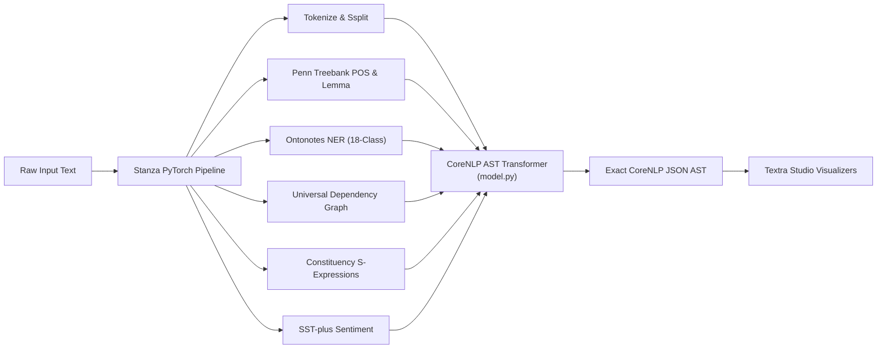

# Textra Python NLP Engine (Stanford Stanza Neural Pipeline)

An in-project, high-performance Python natural language processing engine for **Textra**. Built directly on top of Stanford NLP Group's official Python library (`stanza`) and PyTorch neural models, this engine provides a drop-in, zero-Java alternative to the Stanford CoreNLP Java server.

---

## Architecture Overview



The transformation pipeline in `model.py` maps Stanza's object graph into the exact JSON AST structure expected by Textra's frontend studio:
- **Tokens**: Exact character offset ranges (`characterOffsetBegin`, `characterOffsetEnd`), 1-based token indices, Penn Treebank POS tags (`xpos`), normalized lemmas, and standardized NER entity tags.
- **Dependency Arcs**: Governor-dependent 1-based relationships and Universal Dependency relations (`dep`, `governor`, `dependent`) for Textra's interactive SVG curved arc dependency viewer.
- **Constituency Trees**: Standard bracketed S-expression strings (`(ROOT (S (NP ...) (VP ...)))`) consumed directly by Textra's recursive Penn Treebank tree renderer.
- **Sentiment Analysis**: 5-class sentiment distribution probabilities mapped from SST neural predictions.
- **Open Information Extraction (OpenIE)**: Graph traversal over verb predicates, nominal subjects, direct/indirect objects, and clausal complements to produce structured `(subject, relation, object)` knowledge triplets.
- **Coreference Resolution**: Cross-sentence entity and pronominal reference tracking matching gender, animacy, and number features.

---

## Getting Started

### 1. Prerequisites
- Python 3.10+
- PyTorch (CPU or CUDA)

### 2. Install Dependencies
```bash
pip install -r textra/python_engine/requirements.txt
```

### 3. Run the Microservice
Start the FastAPI server on port 8000:
```bash
# Using npm
npm run engine

# Or directly using Python
python textra/python_engine/server.py
```

The server will automatically pre-warm all 7 Stanford neural models into memory and expose:
- `GET /ping` — Health check endpoint (returns `pong`).
- `GET /` — Engine status and diagnostics.
- `POST /` — CoreNLP-compatible form / raw URL-encoded text endpoint.
- `POST /annotate` — REST JSON endpoint accepting `{"text": "..."}`.

### 4. Direct CLI Usage
You can run annotations directly from your terminal:
```bash
# Pass text as argument
python textra/python_engine/cli.py "Stanford University was founded in California. Chris Manning teaches there."

# Or pipe text via stdin
echo "Natural Language Processing enables computers to understand human language." | python textra/python_engine/cli.py
```
